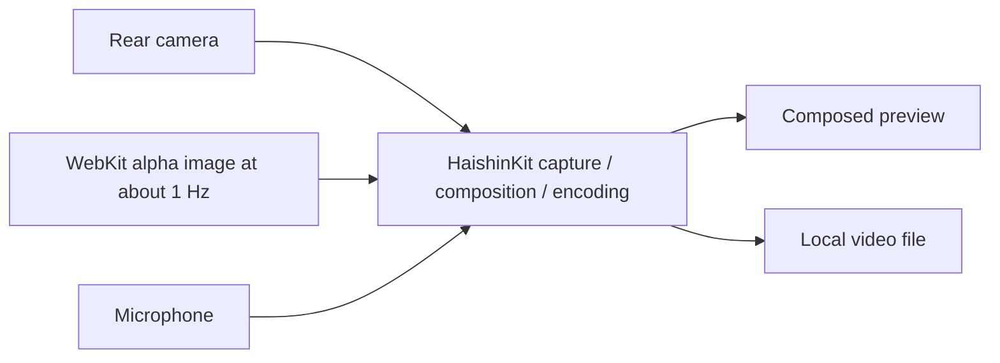

# stream14 application specification and design

Created: 2026-11-01. Updated: 2026-11-07. Status: integrated local recording in development; M1 demonstrated, qualification of M2–M5 pending.
Owner: Slava Kuznetsov. Source-code license: BSD-3-Clause.

This document is the product and technical source of truth. "Required" describes
the agreed behavior. "Starting default" is an explicit engineering choice that can
be revised using measured results. "Feasibility gate" means the approach is not yet
proven and must not be presented as a working capability.

## Owner sequencing and workflow update — 2026-11-06

The owner authorizes full-product development using focused branches from current
main and PRs targeting main. This replaces the temporary 2026-11-05 `codex/full-app`
integration workflow; no integration promotion or MVP backport gate remains.
The [full-app plan](2026-11-05-full-app-implementation.md) supplies issue prompts,
dependencies and A1–A9 delivery work. Older instructions to defer all broadcasting
implementation until MVP qualification do not block this authorized development.

Issue #6 is closed after actual local-only TestFlight delivery and owner review.
Its recorded measurement limits remain: closure does not establish all formal
M1–M5 or full-product gates. Preserve historical build evidence and independently
qualify the later full-app build. Development experiments remain capped at 15 minutes;
longer qualification needs a later explicit agreement. A PR target does not authorize
merging; use independent review and explicit merge approval.

## Owner testing-time update — 2026-11-07

Routine connected-iPhone validation targets five minutes TOTAL, not an hour. Prepare builds and deterministic/Simulator checks on the laptop first; combine a short smoke with only a targeted physical case relevant to the change. The full inventory is a backlog, not every-visit work. If setup consumes the budget, retain a blocked/incomplete result rather than extending silently. Longer runs need explicit agreement; the existing 15-minute development ceiling is not the default. Long-run criteria remain unverified until separately agreed/measured; five-minute smoke results do not establish endurance or waive those criteria.

## Current milestone: local-recording MVP

The owner's 2026-11-01 architecture handoff and subsequent instruction select a
smaller first product: validate HaishinKit camera capture, a transparent web overlay,
and a local video recording before implementing broadcasting. The full YouTube
product remains the destination. Sections below describing YouTube, RTMPS, dual
outputs, and full broadcast qualification are later-stage requirements. TestFlight
installation and operation on the testing iPhone are required for this MVP. This
milestone is being implemented in separately reviewed stages.

### Stage 1: native app foundation (issue #2)

Stream14.xcodeproj provides an iPhone-only SwiftUI app, shared Stream14 scheme,
hosted Swift Testing configuration tests, and XCTest UI tests. The owner confirmed
com.smith3v.stream14 on 2026-11-02. Deployment starts at iOS 27.0; Swift language
mode is 6. The setup screen uses a native Form and system typography, supports
portrait and both landscape orientations, and explicitly states that recording and
web overlays are unavailable. No media controls, permissions, networking, packages,
or extra architecture are introduced. The UI uses main-actor isolation; there is
no capture or processing work yet.

Xcode 27.2 and the iOS 27.2 SDK are installed. See the
[development guide](ios-development-guide.md#physical-setup-verification-2026-11-04)
for exact build/test and physical-device evidence. On 2026-11-04 the signed setup
app launched on the physical iPhone 13 mini with iOS 27.2; the owner confirmed
readability in portrait and both landscape orientations. No M1–M5 media gate or
TestFlight delivery is established by this foundation.

### Stage 2: HaishinKit local media experiment (issue #3)

The app pins HaishinKit 2.3.0 core and links its Logboard runtime dependency. One
single-session MediaMixer in offscreen mode feeds composed MTHKView preview and
StreamRecorder directly, with no ingestion connection. A ScreenActor-owned
ImageScreenObject accepts a full 1920×1080 synthetic transparent counter image
replaced at about 1 Hz. AVAssetWriter encodes uncompressed composed NV12 video
and mixed PCM audio once to H.264/AAC MP4. Original-file export does not transcode.
See [the feasibility report](feasibility.md) for exact APIs, package footprint,
checks, device evidence and current limits.

The experiment retains pending/failed samples with status sidecars and never calls
a returned native recorder URL a production-complete file: upstream 2.3.0 does not
expose a post-finish writer-status check. Stage #5 must address that using a small
writer adapter on the existing MediaMixerOutput boundary or an upstream fix, and
qualify backpressure/error handling. This does not justify replacing library capture
or composition. WebKit, full failure handling, 30-minute performance and TestFlight
remain later gates. The physical 13 mini sample and owner playback confirmation
now demonstrate M1; see the report for the measured file properties and limitations.

### Stage 3: attached WebKit renderer (issue #4)

A separate native overlay test sheet now accepts an in-memory HTTPS URL and
renders an attached, noninteractive WKWebView at 1920×1080 CSS pixels. Public
snapshots at about 1 Hz become immutable 1920×1080 alpha images; independent
monotonic source/render freshness drives the ten-second hide/recovery rule and
manual-hide precedence. Reference-page reloads establish source access; pages
without their own reload get a document refresh after eight seconds. Document
access does not prove health of an independent in-place scoring backend; a
source-specific verified heartbeat is required for that claim. See the
[renderer decision and device evidence](feasibility.md#stage-3-webkit-renderer-issue-4-2026-11-04).
No service deployment, capture pipeline, encoding or dependency change is needed.
Stage #5 must apply the image **and visibility** on the existing ScreenActor image
layer; the current camera experiment still records the synthetic counter. M2–M5
remain pending. The test sheet uses a visible scaled source view; supported WebKit
attachment and cost must be retained/requalified during media integration.

### Stage 4: integrated local recording (issue #5)

MediaSession now owns the single HaishinKit capture/composition session and a
concrete LocalRecorder output. The attached WebOverlayRenderer remains on
MainActor; immutable full-canvas images and visibility transfer to one
ScreenActor-owned WebOverlayLayer. The layer sets HaishinKit `isVisible` explicitly:
clearing its source image alone leaves the library's last cached raster drawn.
A regression observes actual composed NV12 output through hide/recovery. Automatic safe-area content adjustment is
disabled in the browser: a physical landscape test otherwise exposed a 1870-pixel
CSS viewport inside its 1920-pixel view. The common composed output feeds MTHKView
and the local writer, so native controls and the browser source surface are not
part of the recorded picture.

The native 2.3.0 recorder's missing final status and per-sample Task submission
justify the small AVAssetWriter adapter on the verified MediaMixerOutput boundary.
Mutex-owned synchronous admission has no application sample queue; real-time
input readiness drops are counted, append failures stop recording, and completion
requires successful final writer status plus audio/video structural validation.
H.264/AAC encoding happens once here, after HaishinKit composition, directly to
MP4. This adds no capture/compositor/transport abstraction or dependency. A future
transport must independently consume the mixer output; shared encoded fan-out is
not established by this local uncompressed-output path.

UUID files/status sidecars remain under backup-excluded Application Support.
Pending/legacy/failed files are never promoted on relaunch, and export shares the
original file. Complete overlay URLs use device-only, when-unlocked Keychain
storage. Stage #5 originally required explicit Load with no automatic network/
camera/recording resume; issue #38 below supersedes only overlay network resume.
Background/audio/capture interruptions finalize and require explicit restart;
capture runtime errors fail visibly. Serious thermal state reduces raster cadence
to three seconds with a warning; critical state finalizes/stops capture. Writer
failure, missing tracks or metadata-save failure cannot claim a completed file.
See the [stage 4 evidence](feasibility.md#stage-4-integrated-local-recording-issue-5)
and [reproduction guide](ios-development-guide.md#stage-4-integrated-recording-checks).
Qualification remains separate from implementation; M3/M5 require TestFlight.

### Configured overlay recovery and safe URL editing (issue #38, 2026-11-07)

A committed nonempty HTTPS URL now expresses foreground overlay intent. The main
screen reconciles that intent on activation and every second independently of
renderer completion. It loads on launch/foreground return and repairs a stopped
renderer or missing timer without reopening settings. No camera, microphone,
recording or publishing starts as a result. Background entry suspends the browser; transient foreground inactivity (such as
Control Center) preserves it. Media interruptions still require explicit camera resume.
Closing the camera alone no longer stops the independently configured overlay.

The settings sheet owns an unapplied draft. Apply URL validates the trimmed value,
then commits it to device-only Keychain before changing active state. Invalid input
and storage failure preserve the old URL/browser. Dismissing discards edits. Applying
an empty value removes the saved URL, clears/hides the layer and stops all overlay
loading/capture/refresh/retry work. Disabled, paused, unavailable/recovering and
manually hidden are distinct states. Only an explicitly applied nonempty URL can
leave disabled state. URL changes remain locked while capture is transitioning or
recording/finalizing; existing-session source switching is not introduced.

A main-run-loop timer supervises callback-based public WebKit JavaScript/snapshot
operations. There is at most one outstanding capture per browser; a six-second
capture deadline retires a stalled browser rather than accumulating suspended async
capture tasks. Navigation without a commit times out at six seconds and failures
retry after two seconds. Ten seconds without a usable render also recreates the
browser. Successful source access and rendering remain independent of pixel changes;
the existing eight-second fallback document refresh and approximately 1 Hz raster
cadence are retained. The ten-second monotonic stale hide and manual-hide precedence
still apply to the same composed preview/recording layer. Replacing a browser keeps
its nonpersistent configuration (including test content rules); old delegates are
removed and callbacks require current browser identity and navigation generation.
The attached viewport adopts replacement browsers without changing canvas geometry.
This uses public APIs and adds no media encoder, queue, dependency or native bridge.

Recovery covers observable failures while the app can execute; it cannot guarantee
recovery from an unresponsive main run loop, OS suspension or arbitrary app failure.
See the [focused plan](2026-11-07-overlay-recovery-implementation.md) and
[verification procedure](ios-development-guide.md#issue-38-overlay-recovery-and-safe-url-editing).
The hosted suite (32 cases including opt-in skips), four focused UI/accessibility
checks, unsigned Release and a short physical 13 mini/iOS 27.2 recovery recording
passed. Full audio/video decode and extracted frames confirm recorded hide/restore.
The final 27.7275-second stress clip averages 29.325 fps with no >=500 ms gaps and
zero writer admission drops; 22 estimated missing output intervals remain. This
does not establish smooth-30 or long-run qualification. Actual OS process kill,
physical VoiceOver and numerical A/V synchronization remain unverified; see the
guide for evidence and the corrected single-renderer test harness.

### Owner update: cleanup and development experiments (2026-11-05)

The saved-recordings list offers a confirmed Delete action for one UUID's original
video and metadata, including pending/failed recordings. Status metadata is removed
last so incomplete deletion remains retryable; exported copies are kept. Deletion
is disabled during recording/setup/finalization. There is no automatic cleanup or
available-space estimation/polling. This supersedes the earlier experiment's
always-retain policy only after explicit owner confirmation for a selected record.

Issue #30 refines this list on the full-app integration branch: each recording
shows date/time beside its original MP4's current logical file size, formatted
with readable units. Missing/unreadable/nonregular files say “File size unavailable”
and disable Play/Export; a real empty file can report zero. One horizontal row of
Play, original Export and confirmed Delete icons has dated VoiceOver labels and
at least 44×44-point targets. Date/size text wraps for Dynamic Type. There is no
persisted size, capacity polling or estimate. Carry this behavior into issue #23's
recordings screen, including failed/pending entries and unchanged confirmation.

Current development experiments are capped at 15 minutes; longer integrated
whole-app qualification is deferred until an agreed later run. Fifteen minutes
must not be labeled a completed long-run M3/M5 gate. The app's normal Record/Stop
operation is not given an artificial fifteen-minute recording limit.

The teal camera/14 icon identifies stream14. Separately installed test apps need
distinct icons; the UI-test runner has a purple flask/UI icon and separate name.
Hosted unit tests run inside stream14 and do not install another application.

### Stage 5: TestFlight release preparation (issue #6)

The delivery stage retains the existing media behavior and package pins. An
app-level PrivacyInfo.xcprivacy declares elapsed-time calculations for overlay
freshness (35F9.1) and app-container file metadata access for safe deliberate
deletion (C617.1). It declares no developer collection/tracking. The configurable
WebKit overlay still contacts its website and subresources; this is explicitly
covered in the [privacy policy](privacy.md) and must be considered in submission
disclosures. A standard Privacy policy link is available at the bottom of setup
beside Third-party notices, stacking when larger text needs more space.
Native AnyLayout preserves the controls when accessibility text changes the footer
from a row to a column. Portrait/both-landscape normal/largest-text Simulator
layout and scoped accessibility audits pass; physical VoiceOver acceptance remains
pending. The link remains
available before camera permissions. Its main-branch policy URL must be published and verified before
upload. No transport or account feature is added.

The [delivery record](testflight-delivery.md) separates packaging from signed
upload, processing, TestFlight installation and M1–M5 evidence. Membership, signed
upload, internal distribution and owner TestFlight use/export are now confirmed.
The owner reviewed a 35 min 26.410 s original recording and reports correct picture,
sound and overlay; file cadence/decode checks and remaining qualification limits
are in the [owner verification report](feasibility.md#owner-testflight-recording-and-review-2026-11-05).
Numerical start/end A/V sync and this run's memory/queue stability remain unverified.
Owner-requested closeout does not turn those formal M3/M5 criteria into passes.
Archive/upload do not require a phone; device work waits for owner availability and tolerates
disconnection without deleting originals or automatically retrying capture.
Any additional formal qualification requires a separately agreed run, start/end
sync markers and a defined delivered-build memory measurement route. The current
hosted development harness is not that TestFlight measurement route.

### Rear-lens selection (issue #33, 2026-11-06)

The owner requested phone-specific rear-camera choices, particularly the wider
0.5× ultra-wide view, followed by testing on the paired iPhone 13 mini. This is an
authorized scope extension to the wide-only starting default. Wide remains the
launch default. After camera permission/open, a Camera button opens a native
lens-choice dialog offering only discovered
physical rear ultra-wide, wide and telephoto lenses with a compatible 1920×1080
video-range NV12 format supporting 30 fps. Telephoto is named without inventing a
phone-specific magnification. No device-model table or digital 0.5× zoom is used.

Discovery runs off MainActor. The selected Sendable lens identity is passed to the
existing HaishinKit MediaMixer actor; device lookup/configuration stays there.
The session uses input-priority capture and selects the compatible format, SDR,
1× device zoom and 30 fps explicitly. Configuration uses the throwing public
`configuration(video:configuration:)` API after `attachVideo`: upstream 2.3.0's
optional attach callback uses `try?` and cannot report configuration failures.
Preview changes stop the mixer briefly, replace its one camera input, then restart
it. Failure restores the prior lens; restoration failure stops capture honestly.
The selected lens feeds the same composed preview/LocalRecorder output. This adds
no camera session, encoder, dependency or network output. Changing a lens is locked
while preparing, recording, finalizing or stopping; interruption still stops capture.
Selection lasts for this app session, with Wide restored at a fresh app launch.
Seamless changes during recording remain outside scope. The Camera button's label
owns a minimum 44-point touch height and exposes the selected lens as its accessible
value. Physical testing rejected a menu-style Picker's 34-point intrinsic target;
the native button/dialog passed both landscape layouts, selection, record lock and
playback checks on the 13 mini. On 2026-11-07 the owner confirmed the wider view
and comfortable landscape controls. See the guide for exact results and remaining
hardware/qualification limits.

Owner UI refinement (2026-11-07): the selector shares the preview's visibility
boundary and disappears when capture closes, even though discovery and the chosen
lens remain remembered in memory. Its compact standard bordered button shows a
camera icon and short magnification (0.5× / 1×, or Telephoto) with the same internal
44-point minimum target. Full lens names remain in the dialog and accessible value;
the recording-lock explanation is an accessibility hint rather than a separate
space-consuming caption. Recording still disables selection.

Device evidence and owner visual review are recorded in the development guide;
unavailable hardware, long-run performance and future streaming remain separate
qualification requirements. Existing MVP TestFlight evidence is not proof of this
new development build.

### MVP scope and interface

Issue #34 (2026-11-07) removes the separate browser-source strip from the main
screen. A top-aligned ZStack retains the nonzero 60-point attached WebKit host
behind the opaque system-background ScrollView; the scrolling content fills the
available area without reserving that strip's height. The browser itself remains
attached, unhidden and at alpha 1 with its 1920×1080 CSS canvas. Overlay status,
manual hiding and URL settings remain available, and the composed camera preview
and recorder retain the same WebOverlayLayer handoff. Covered-host snapshot
evidence and remaining device limits are recorded in the development guide.

- Rear camera (Wide by default), microphone, landscape 1920×1080 at 30 fps on iPhone 13 mini
  with iOS 27. Use the main profile's starting encoding settings below. No 720p,
  60 fps, HDR, lens changes during recording, manual exposure, or advanced audio controls yet.
  Owner-authorized follow-up #33 adds rear-lens selection before recording; see above.
- HaishinKit is the first choice to own acquisition, composition, encoding, and
  recording through its verified public APIs. The app owns WebKit snapshots and
  straightforward UI/orchestration. Do not start by building custom capture/encoding
  components or adding a second camera session.
- One configurable HTTPS overlay URL, full 1920×1080 canvas, alpha preserved, with
  approximately one snapshot per second. Retain the last good image through brief
  reloads/errors; hide it after 10 seconds without confirmed source access or a usable
  render, and restore it automatically on recovery. Smooth camera video has priority.
  A small in-place DOM update change
  in the overlay project can be considered if needed; it is not part of this change.
- One native recording screen with composed preview, Record/Stop, recording duration
  and status, permission/error messages, a URL settings sheet, and playback/export
  of saved files through system UI. No YouTube controls, account setup, or full
  recordings-management interface is needed to validate the idea.
- Available-storage stats, remaining-recording-time estimates, capacity polling, and
  proactive capacity thresholds are deferred improvements. Handle actual disk-full
  and writer errors now; no storage estimator is needed for MVP completion.
- Save composed video/audio through the native HaishinKit/AVAssetWriter path with
  one necessary H.264/AAC encoding stage after composition. Use MP4 as the starting
  container because it is HaishinKit's default; choose MOV if the verified path avoids
  additional encoding/conversion or is otherwise simpler. Both are native containers;
  do not claim one is cheaper from the extension alone. Avoid saving and subsequently
  transcoding, and export the original file without conversion. Document the actual
  codec/container, sample formats, and encoder ownership.
- Start/stop repeatedly, keep the screen awake while recording, restore normal sleep
  afterwards, and finalize on stop/interruption. Show a visible failure and preserve
  saved data if recording fails. Without a network output there is no broadcast to
  continue on recorder failure. Do not automatically resume recording after returning
  from background or after relaunch.
- No YouTube/OAuth, ingestion connection, speculative transport packages, streaming retries, shared
  encoded-output fan-out, backend, or Google setup in this stage.
  Develop with Xcode, then archive/upload and install the MVP through TestFlight on
  the testing iPhone. No internet is required by recording
  itself; the configured web overlay still needs its own network resources.

Link the core HaishinKit product first. If the verified local recorder API requires
another product, document that specific dependency before linking it; this does not
add network transmission to MVP scope. Avoid custom media work solely to remove a
small, required library product.

### MVP acceptance and decision gate

| Gate | Required evidence on the physical iPhone 13 mini |
| --- | --- |
| M1: Library fit | A stable HaishinKit version builds with the chosen Xcode/iOS 27/Swift 6 setup. Document exact public APIs, product/dependency/license footprint, capture/encoder ownership, sample formats, codec/container choice, dynamic image layering, and local-recording route. Verify one necessary local encoding path with no decode/re-encode or export transcode; recording works without an ingest connection. |
| M2: Actual composition | A saved 1920×1080/30 fps sample and preview contain camera, audio, and the same full-frame web overlay. Check alpha/translucent edges/logos, layout, orientation, a visible score update during recording, and absence of app controls. Repeated reference-page reloads cause no white/blank flashes. |
| M3: Smooth recording | A 30-minute run of the TestFlight-installed MVP has less than 1% measured pipeline frame drops, no repeated video stalls of 500 ms or more, no monotonic memory/queue growth, and measured A/V offset within 100 ms at start and end. Document the build, measurement method and any library observability limits; Xcode-only measurements are preliminary. |
| M4: Local usability and failures | Repeated start/stop produces independently playable/exportable files. Test permission denial, overlay unavailability/reloads, a two-minute overlay-network outage, camera/audio/background interruption, and an injected disk-full/write failure. During the outage local A/V continues; retain the last overlay briefly, hide at 10 seconds, and restore after fresh source access/rendering. Test a brief outage, an unchanged healthy score, cached snapshots during a failed source refresh, and manual hiding during recovery. Interrupted recordings finalize where possible and the UI reports the actual state; failed/incomplete files are not marked complete. Capacity prediction is not required. |
| M5: TestFlight delivery and owner review | Archive/upload the signed MVP, invite the owner/tester, and install it via TestFlight on the testing iPhone 13 mini. Exercise recording, overlay updates/hide/restore, stop, playback/export, and the M3 run in that build. Record version/build, device/OS, installation route, and results without private tester data. Present samples and the M1–M4 report for owner review before broadcasting work; Xcode-only installation does not pass this gate. |

Crash-fragment recovery, a three-hour soak, wider device coverage, simultaneous local
recording plus RTMPS are later gates. TestFlight delivery is part of M5. Preserve incomplete files now,
but do not introduce a custom recovery system solely to finish this first experiment.
A passing MVP does not prove those later capabilities. If library composition or
recording is unsuitable, report the concrete limitation and review a minimal native
adapter or fallback with the owner rather than silently expanding the pipeline.

Record actual APIs and measurements in docs/feasibility.md when implementation
begins; do not create a report claiming success before any device work exists.
The implementation plan covers only this first milestone through M1–M5 and review;
prepare a separate streaming milestone plan after the owner reviews the local app.

## 1. Full-product purpose and agreed requirements

Enable one person to broadcast a long volleyball event from an iPhone without a laptop-based
video mixer. The operator prepares an event in YouTube Studio, opens stream14,
checks the picture and sound, selects that event, and broadcasts with a web overlay
and a local backup.

| ID | Required behavior |
| --- | --- |
| R1 | Capture iPhone camera video and microphone audio. |
| R2 | Load an operator-configurable web URL and composite its transparent, full-frame canvas into the actual video. |
| R3 | Authorize access to YouTube, show the authorized channel and its scheduled events, and let the operator select one. |
| R4 | Resolve or establish that event's ingestion-stream binding, transmit media, and start the selected broadcast. |
| R5 | Save the same composited video and audio locally as a video file. App controls and warnings must not enter the output. |
| R6 | Keep local recording independent of streaming availability for as long as storage and capture/writing remain healthy, including startup failure, transport loss, failed retries, and remote event completion. Reconnect to the same event when possible; streaming failure alone never stops the writer. |
| R7 | If recording fails after broadcasting begins, continue broadcasting and display a persistent warning. Preserve previously saved footage. |
| R8 | Target landscape 1080p30 events lasting approximately one to three hours. Smooth video takes priority over overlay update latency. |
| R9 | Qualify on iPhone 13 mini with iOS 27, and also validate on iPhone 15 and 17 families, including available Pro models. |
| R10 | Use a public GitHub repository, BSD-3-Clause, and TestFlight for the owner and a few invited testers. Prefer native frameworks and minimal justified dependencies. |
| R11 | Hide an overlay after 10 seconds without confirmed source access or a usable render; restore automatically after source access and a fresh render recover, unless the operator manually hid it. Apply this to preview, local recording, and streaming. |

The owner permits changes to the overlay implementation if needed, including
replacing full-page refreshes with in-place updates. Such a change belongs in the
overlay's own project and is not part of this repository's initial documentation
change. It must preserve the configurable web-URL feature.

## 2. Full-release boundaries and starting defaults

| Area | Starting default |
| --- | --- |
| App name / repository | stream14 / smith3v/stream14; display-name styling can change before distribution |
| Platform | iPhone only, iOS 27.0 deployment target; no older-OS compatibility work initially |
| Camera | One selected compatible rear lens; Wide by default, Ultra Wide/Telephoto where available (#33); autofocus and automatic exposure; basic supported zoom control |
| Audio | System-selected microphone route, initially qualified with the built-in microphone; mute and visible level meter |
| Orientation | Landscape broadcast canvas, fixed for a session; setup and recordings screens can also work in portrait |
| Main profile | 1920×1080, 30 fps, SDR Rec. 709, H.264 video and AAC audio |
| Lower-bandwidth profile | 1280×720 at 30 fps; selected before a session, without changing resolution during an event |
| Encoding | CBR target, two-second keyframes; initial video targets 14 Mbps for 1080p and 8 Mbps for 720p; AAC 128 kbps stereo at 44.1 kHz, converting the input route as needed |
| Overlay | One HTTPS URL; one full-canvas layer; approximately one raster capture per second, plus a capture after a successful load when practical |
| Backup | One native MP4 (default) or MOV file for an uninterrupted session, selected for the simplest encoding/writing path; new files after capture interruptions |
| Operation | Foreground app with automatic screen sleep disabled during recording/broadcasting and restored afterwards |
| Data / services | Direct phone-to-YouTube upload; no application account, relay server, analytics SDK, subscription, or cloud backup service |

The initial bitrates use [YouTube's current encoder recommendations][encoder].
They are not a promise that a given network or phone can sustain the profile.
Measure both profiles before release and document any change rather than silently
reducing the 1080p30 requirement. Do not add 60 fps, HDR, or Pro-only processing to v1.

Creating or editing scheduled broadcasts, changing their visibility, chat overlays,
multiple cameras or overlay layers, live lens switching, portrait broadcasting,
manual RTMP destinations, browser audio, web-page login flows, and background or
locked-screen capture are outside v1. A local rehearsal recording is included so
the operator can test the complete composition without going live.

## 3. Operator experience

### Prepare

The main setup screen presents a composed preview and concise readiness information:
camera/microphone permission, active audio route, overlay loading state,
selected output profile, and YouTube
connection/channel/event. Use standard navigation to Settings and Recordings.

Request camera and microphone access when the operator first opens the preview,
explaining both capture and broadcasting. If denied, explain how to enable access
in Settings; do not keep triggering permission prompts. Preview and local rehearsal
must work without connecting a Google account.

Settings allows editing and explicitly applying an overlay URL draft and selecting the output profile.
A committed URL loads automatically while the app is active; unsaved edits never
change the active source. Validation or secure-storage errors preserve the current
configuration. Applying a replacement URL is restricted to idle/preview state.
An empty URL means overlay disabled, stated explicitly in readiness status. The
reference URL is offered as a copyable example, not fetched silently on first launch.
Before a broadcast, a configured overlay must have rendered successfully; if it
cannot load, the operator may explicitly disable it and recheck the preview.

Connect YouTube through Google's supported authorization UI, then display the actual
authorized channel identity. Paginate scheduled events, show title, scheduled time
in the device's locale/time zone, visibility, and eligibility. Provide refresh and a
useful empty state with instructions for scheduling an encoder broadcast in Studio.
Changing accounts clears the previous channel's selection and credentials as appropriate.

### Go live

The final action names the channel, event, and visibility. A clear confirmation
starts this specific event and local recording; opening settings, selecting an
event, or previewing the camera never transmits camera media to YouTube. Check
permissions, output configuration, local writer readiness, overlay readiness, authentication, and
event state again before starting.

Start the local writer before publishing media. If backup initialization fails,
do not start the broadcast. Once broadcasting has begun, R7 governs later failures.
Show progress through connecting, waiting for YouTube ingestion, and going live.
Report "Live" only after YouTube confirms the broadcast state. Local recording and
upload connection are separate indicators even during this progress sequence.

### During the event

Use a large, correctly letterboxed preview, elapsed time, microphone level/mute,
zoom, and clear status for YouTube, upload, overlay, and backup. Keep recording-failure
and thermal warnings available without covering the picture unnecessarily. Starting resolution,
canvas orientation, event, and URL stay fixed; provide overlay reload and hide/show
controls rather than navigation that could accidentally change the active event.
Settings changes made later apply to the next session.

The operator can distinguish "Reconnecting; recording continues", "Backup failed;
still live", and "YouTube status unavailable". Warnings are native UI and never
part of the encoded picture. Do not play warning sounds into an active microphone.

### Finish and review

"End broadcast" confirms that the selected YouTube event will end. Request remote
completion, disconnect upload, and finalize the recording regardless of any API
failure. A bounded remote request must not indefinitely delay local finalization.
If completion cannot be confirmed, say "YouTube end not confirmed" and offer a
link to Studio; never imply the remote event ended merely because upload stopped.

The recording screen lists local sessions with date, duration, size, and complete,
interrupted, or failed status. It supports playback, explicit export through the
system share/Files interface, and confirmed deletion. Never delete a local copy
automatically after export, sign-out, or a failed broadcast.

### Interface acceptance

Follow the current [Apple Human Interface Guidelines][hig]. Use native controls,
system text styles and SF Symbols, at least 44-point touch targets, VoiceOver labels,
and text/icons alongside colors. Support larger text in setup and recordings without
truncating essential actions. Test landscape operation on the 13 mini, including safe
areas, permission-denied screens, keyboard entry, and failure warnings. Preserve the
complete 16:9 output in preview; safe areas affect controls, not the video canvas.

## 4. Browser overlay contract

Reference: [the supplied scoreboard][overlay], inspected on 2026-11-01 through a
desktop browser. At inspection it displayed a finished-match scoreboard with logos,
transparent html/body backgrounds, translucent panels, and a JavaScript timer that
reloads the page every 2,000 milliseconds. Its CSS switches to a different layout
at widths at or below 720 pixels. This observation is not an iOS compatibility test
or a claim about other states of the scoreboard.

Required rendering behavior:

- Treat the page viewport as exactly the selected output canvas: 1920×1080 CSS
  pixels for the main profile or 1280×720 for the lower profile. Normalize the
  resulting raster to the same number of video pixels. Do not use the phone's
  display scale to accidentally produce a 3× raster or a narrow mobile layout.
- Preserve full transparency and partial alpha, including antialiased text, shadows,
  logos, and translucent panels. The page defines placement; v1 has no drag/resize
  editor, chroma-key step, or native recreation of the scoreboard.
- Run normal WebKit HTML/CSS/JavaScript and same-page network updates. Output does
  not include scrolling chrome, web permissions, app UI, or browser audio. A
  nontransparent area supplied by the page remains nontransparent; do not secretly
  rewrite arbitrary page styling to remove it.
- Capture at approximately 1 Hz with at most one outstanding capture, reusing an
  immutable last-good raster between captures. Drop/skips of overlay work are
  acceptable under load; stalled camera delivery is not. Smooth animation and
  camera-rate browser rendering are not requirements.
- Keep the last good frame during brief reload, navigation, and transient snapshot errors.
  Promote a new frame after a usable load and render, with resource readiness bounded
  so a failing logo/font cannot freeze capture forever. Do not add an app reload
  timer on top of the reference page's own timer.
- Track source-access health separately from raster capture. A successful page/source
  refresh or health heartbeat counts even when the score is unchanged. Taking another
  snapshot of cached/stale content does not reset source freshness. For in-place page
  updates, establish a minimal source-health signal before claiming to detect their
  network failures; public browser reachability alone does not prove a scoring backend
  is reachable.
- Use a 10-second grace period measured with monotonic time. If confirmed source
  access or usable rendering has been missing for 10 seconds, automatically remove
  the overlay layer from preview, recording, and streaming. Preserve camera/audio
  continuity and show an operator-only overlay-unavailable status. Keep retrying
  without blocking capture. Brief outages keep the last good image without flashing.
- After source access succeeds and a fresh usable image is rendered, automatically
  show that image again and clear the outage status. Do not restore a cached frame
  on network reachability alone, and do not override an explicit manual hide.
- Permit HTTPS URLs with normal certificate validation. Prevent popups, downloads,
  and requests for camera/microphone/location/native access from the page. Do not
  expose credentials or native message handlers to arbitrary overlay content.
  Interactive website sign-in and DRM/video/WebGL compatibility are not promised.

Use WKWebView and public capture APIs first. Apple's [snapshot API][snapshot]
produces an asynchronous image, not a guaranteed real-time video feed. The capture
experiment must verify full-viewport capture, alpha, reload behavior, and performance
with a view attached/rendered in a supported way; do not assume a hidden or detached
web view will render correctly.

If the current page's full reloads cause blank frames or video load, first try a
small change in the overlay project that updates existing DOM content rather than
reloading the document. Document the source endpoint and change there before use;
no undocumented native-to-page protocol is assumed here. Reassess the experience
before adding a new rendering framework or changing the general web-URL contract.

## 5. YouTube authorization and broadcast lifecycle

Use one iOS OAuth client tied to the final bundle identifier. Start with the Google
Sign-In SDK candidate because it implements the supported iOS authorization and
token-management flow. Use URLSession/Codable for the small YouTube REST surface;
a general Google API client or Firebase is not required.

Request a single write-capable YouTube scope required by the chosen endpoints:
`https://www.googleapis.com/auth/youtube.force-ssl`. Explain the requested access;
read-only authorization cannot bind streams or start/end broadcasts. Do not request
additional unrelated data. Store tokens through SDK-managed Keychain storage and
refresh before calls. Never use the overlay browser to collect Google credentials.

| API operation | App use |
| --- | --- |
| channels.list, mine=true | Resolve/display the authorized channel; no assumption that email identifies the channel |
| liveBroadcasts.list, broadcastStatus=upcoming | List scheduled events with snippet/status/contentDetails and all pages |
| liveBroadcasts.list, id=… | Recheck the selected event and reconcile uncertain transitions |
| liveStreams.list, id=… | Resolve an existing bound stream, RTMPS endpoint/key, ingestion activity and health |
| liveStreams.insert | Create an app-owned ingestion stream only when the event has no binding |
| liveBroadcasts.bind | Bind that new stream to the selected upcoming event |
| liveBroadcasts.transition | Explicit transitions to live and complete when the current state permits them |

`broadcastStatus`, `id`, and `mine` are alternative filters for liveBroadcasts.list;
do not combine them. Use the endpoint reference rather than copying an example
that combines filters. See [broadcast listing][broadcast-list], [stream creation][stream-insert],
[binding][bind], and [transition rules][transition].

Reuse an existing compatible binding without changing it. Refuse an ingestion stream
already active or shared with another unfinished event; explain that the user should
configure a dedicated stream in Studio. Do not take over another encoder or silently
replace an incompatible binding. If there is no binding, create one non-reusable,
app-owned RTMP ingestion resource, request variable resolution/frame rate where
supported, and use its returned RTMPS endpoint. Track the created ID immediately so
retrying a later bind does not repeatedly create resources. An ambiguous create
response requires reconciliation or operator action, not blind repeated insertion.

F5 implementation (2026-11-07): `YouTubeBinding.prepareConfirmed` is an explicit
component for the later Go Live coordinator; listing, selection and preview do not
invoke it. It checks the actual channel and selected event again, then checks all
pages of `broadcastStatus=all,broadcastType=all` for other unfinished bindings.
Existing reusable streams are not presumed shared: known ready/inactive, healthy,
profile-compatible streams can be reused only after current dedication is established.
Unknown lifecycle/health/reuse/compatibility information fails closed. Newly created
streams request RTMP with paired variable resolution/frame rate and `isReusable=false`.

An atomic, backup-excluded local journal stores only operation/channel/event/profile
and known created-resource IDs plus phase, independently for each channel/event.
Completing one event does not block another or discard an older unresolved create.
The `inserting` phase is written before
POST; a successful response ID is saved before cancellation/account-change rejection.
Malformed/timeout/server-failure insert results become unresolved and never trigger
another blind insert, including after relaunch. Definitive API rejection or credential
preflight failure permits a later explicit retry. Known created IDs survive binding
failure and are read before retrying; binds are sent once and reconciled by event ID.
The workflow has one in-flight operation and a 45-second deadline with cancellation.
No automatic remote deletion/unbinding or editorial/auto-start/auto-stop updates occur.
When Studio resolves an ambiguous request by binding the event, verified readback
marks that journal entry prepared without inventing a known app-created ID. If that
event later becomes unbound, the prior unknown-create guard still prevents blind insertion.
Raw responses and credentials are not persisted; credential values redact diagnostic
descriptions/reflection. Physical signed-account/unlisted-event API acceptance remains
pending; deterministic fixtures do not establish live service acceptance.

Fetch `rtmpsIngestionAddress` and the stream name/key from YouTube; do not manufacture
an insecure RTMP fallback. Use TLS certificate and hostname validation. RTMPS and
the relevant ingestion fields are described in [YouTube's ingestion guide][rtmps].

Inspect auto-start/auto-stop settings before transmitting:

- Do not change event visibility, title, audience settings, or auto-start/auto-stop
  settings silently. Require the operator to disable auto-stop in Studio for v1 so
  an internet outage does not automatically complete the scheduled event.
- If auto-start is enabled, the confirmed Go Live action authorizes publishing;
  the first transmitted media may itself start the event. Never publish in a
  supposedly private preparation state. Poll for confirmation instead of issuing
  a redundant transition.
- For manual start, publish only after Go Live, wait for the bound stream to become
  active, then request live and verify the event's lifecycle. The optional testing
  state is not required for v1; local rehearsal supplies the preflight check.
- Never repeat a timed-out transition without first reading the current state.
  If the event is completed, do not create another event or claim to resume it.

Poll at about two-second intervals during a bounded startup window of 60 seconds,
and about ten seconds while live. Back off on service errors/rate limits, respect
retry guidance, and avoid tight polling during outages. If startup times out, stop
upload but keep a healthy local recording running; reconcile whether YouTube went
live before offering another stream start. Keep errors such as disabled live streaming, wrong
channel, missing event, insufficient permission, quota exhaustion, and expired consent
distinct and actionable. A failed status check does not require terminating a
healthy ongoing media connection.

### F7 confirmed lifecycle implementation — 2026-11-08

`BroadcastSession` is a concrete MainActor coordinator over the same App-owned
`MediaSession` displayed in SetupView, plus the concrete authorization/client/binding
components. It does not own another capture pipeline or encoder. `BroadcastIntent`
freezes the current authorization generation, actual channel, event title/visibility
and auto-start choice, profile and overlay URL after the operator requests the
confirmation; no request/publish occurs merely to display that confirmation.
Native configuration/selection controls lock while a session is in progress.
Local rehearsal, microphone and zoom controls remain independent.

After confirmation, the coordinator requires the actual local writer to have
accepted media (`hasStartedWriting`), not merely a return from `record()`. It waits
up to five seconds for that admission inside the overall 60-second startup bound,
then re-reads the channel/event and resolves F5 binding. Changed confirmation
metadata or unavailable configured-overlay render stops startup before publication.
An empty applied URL is explicit overlay disable. The same frozen settings and
account generation are checked across awaited work. A failed startup disconnects
upload and retains a healthy recording; it never uses whole-session stop to handle
an API/transport error. Explicit cancellation owns/cancels the connection Task, so
F6's guarded connection cannot attach after cancellation.

The client sends bodyless `liveBroadcasts/transition` POSTs once, with
`id`, `broadcastStatus` and `part=snippet,status,contentDetails`. Manual events
wait for active ingestion before one live request; auto-start events only poll.
A current broadcast read must return `live` before the coordinator presents Live.
No optional testing transition is implemented. Unknown/late states or deadline
expiry stop startup upload and require read reconciliation before a new start.

A backup-excluded, protected local journal retains only unresolved channel/event
IDs before any possible upload, including auto-start, plus a transition type and
operation ID before a live/complete mutation. Relaunch never reconnects or
publishes; it offers read-only reconciliation using the current authorized channel.
Corrupt/unwritable journal state disables Go Live rather than overwriting evidence.
Pending IDs are cleared only after a confirmed terminal event or an upcoming event
with inactive/ready ingestion and no ambiguous transition. A currently upcoming
read cannot clear an uncertain live request: it may still apply later, including
after relaunch. Resolve that exact event in Studio and reconcile its live/terminal
state; the app supplies no blind reset/retry override. A RAM outstanding-request
gate also prevents reconciliation or a second mutation while the original request
is still awaiting a response after the UI deadline/cancellation. A confirmed still-live event remains pending and
can be explicitly ended. Credentials, event metadata and overlay URLs are not
written to this journal; F5's separate mutation journal remains authoritative for
resource creation/binding ambiguity.

Confirmed End invalidates/cancels startup and immediately requests whole local
capture/output stop, independently of remote work. It reads the event before any
complete mutation, sends at most one complete request per explicit attempt, then
reads for confirmation within a 15-second remote deadline. A request ignoring
cancellation cannot hold up local shutdown or later overwrite the UI with a stale
success. Unknown completion stays pending with Studio and reconciliation actions;
local file finalization/status remains separately owned/presented by MediaSession.
Expired authorization can be reconnected after upload/startup has stopped; an
active session requires End first. F8/F9 still own ongoing remote supervision,
reconnect and full interruption/degradation behavior.

The [F7 handoff](2026-11-08-broadcast-session-implementation.md) records fixture,
build/review evidence and pending signed-phone/unlisted end-to-end acceptance.
No real service mutation, camera upload or physical qualification is established
by this implementation.

The Google account may authorize a Brand Account channel. Show and test the actual
authorized channel; do not assume all Studio-delegated channel roles work with the
API. Reauthorization/channel selection is required if the wrong channel is returned.

## 6. Local recording and storage

Record the pre-upload composition and audio, not a downloaded YouTube rendition.
Network losses therefore create gaps only in the remote output, not in the backup
while capture and local writing remain healthy. The clean-stop result must be a
playable, shareable MP4 or MOV with the chosen dimensions, orientation, and synchronized audio.

Once local writing has started, inability to start or maintain a stream must never
stop it: this includes API/startup errors, RTMPS failures, exhausted retries, and an
event ended remotely. Continue until the operator stops recording or capture/writing
itself fails (including storage exhaustion) or is interrupted. Show recording
status separately and provide an explicit Stop recording action when streaming is
unavailable. An intentional End broadcast/recording action still ends both outputs.
An overlay outage changes only the overlay layer under R11, not recording continuity.

Use HaishinKit's verified local recording path first; add a small AVAssetWriter
adapter only if necessary. Select the native writer/container path as defined above. Later, prefer
one encoding pass feeding both file and RTMPS output if the library exposes this
cleanly. Do not assume APIs or packet access exist. If a second encode is necessary,
measure its thermal and performance cost before accepting it.

The composited camera frames require an initial encode; "avoid re-encoding" does
not mean the file can bypass that necessary step. Apple's [writer input][writer]
supports passing acceptable already-compressed samples through with nil output
settings. Use that only where the selected public API actually provides suitable
samples; changing an extension does not create passthrough. HaishinKit's inspected
[2.2.5 recorder][recorder] supports both MP4 and MOV via AVAssetWriter, defaults to
MP4, and supplies H.264/AAC encoding settings. This supports the starting MP4 choice,
not a claim of shared encoded output or measured resource superiority. Do not add
transcoding, a format-picker UI, or a custom pipeline just to switch containers.

Store working and completed recordings in the app's persistent Application Support
area, excluded from automatic device/iCloud backup. Use a UUID and timestamp for
filenames, an in-progress marker, and a small Codable session manifest; no database
is needed. Only mark a file complete after writer finalization succeeds. An interrupted
capture starts a new file rather than appending a new timeline to a closed movie.

Later, evaluate fragmented writing for the chosen container with an initial ten-second interval and
recovery of fully written fragments after process termination. Apple's
[fragment-writing documentation][fragments] describes a recovery mechanism, not a
guarantee that any interrupted file will play. Qualify the selected container/writer
combination and recovery/export behavior on the device. Keep incomplete files for
recovery or explicit deletion; never silently discard them. A crash can still lose
the current fragment and must be described honestly.

Early F11 laptop evidence (2026-11-08): [native MP4 recovery probe](2026-11-08-native-fragment-recovery-feasibility.md)
reads and passthrough-remuxes completed ten-second fragments after SIGKILL of an
owned synthetic H.264/AAC writer child; a pre-first-fragment file cannot be opened.
Originals remain unchanged. This supports retaining MP4 as the recovery candidate,
not production adoption or A5: repeat on the F6 compressed writer and physical
13 mini, preserve truncated/interrupted status and disclose lost tail media.

Storage reporting and forecasting are deferred improvements, not MVP requirements.
There is no required free-space display, time-remaining estimate, periodic capacity
polling, or fixed 1 GiB/250 MiB reserve policy. Do not implement those thresholds
implicitly as part of writer readiness.

iOS does provide a native [volume-capacity query][capacity], including
`volumeAvailableCapacityForImportantUsageKey`; the reason for deferral is scope,
not absence of an API. A future simple check can be evaluated separately without
promising an exact recording duration or reserved space. Do not add a custom storage
model or dependency for this MVP.

Handle actual recording initialization, append, and finalization failures, including
disk-full errors surfaced through HaishinKit/the native writer. Report the failed
recording, attempt supported finalization where possible, retain usable/incomplete
files, and never mark a failed file complete. Do not promise the current file is
recoverable after storage exhaustion. Test this with injected failures rather than
filling the user's device. For the later broadcaster, a recorder failure must still
leave healthy streaming running with the explicit degraded-backup state.

Playback/export requires no Photos-library permission. Export is deliberate; the
system Files picker can include iCloud destinations. Explain that a file kept only
inside the app is lost if the app is deleted. Do not call this local copy a disaster
recovery backup until the operator exports it elsewhere.

F1 audit (2026-11-07): pinned/latest HaishinKit 2.3.0 does not publicly
expose independently running outgoing compressed samples: its outgoing codecs
are package-only and start/stop with publish/close. A StreamOutput observer sees
raw input, so it cannot feed a passthrough local writer. Public compressed H.264
CMSampleBuffer and AAC AVAudioCompressedBuffer RTMP ingress exist; a future
app-owned shared encoder could use them while preserving HaishinKit capture and
composition. That adapter's live timing/priming/reconnect behavior remains unproven.
The [F1 feasibility audit](feasibility.md#full-app-f1-public-dual-output-api-audit-2026-11-07)
compares this with library-native separate encoding. Production keeps its existing
single local encode until physical evidence and explicit architecture review select
a dual-output path. Test-only RTMP experiments do not authorize production adoption.

F6 preparation adds a test-only native single-encoder/file-fan-out candidate and a
reviewable, unadopted package admission patch. Synthetic compressed-file bytes,
explicit AAC trim-origin handling and independently decoded midpoint markers pass
Simulator checks; these are not physical or receiver evidence. See the
[F6 feasibility record](feasibility.md#full-app-f6-isolated-single-encoder-and-output-admission-preparation-2026-11-07)
for retained failures, proposed bounds and unresolved adoption/qualification gates.
No production encoding, transport or recording-lifecycle selection changes yet.

On 2026-11-08 the owner/root authorized a draft app-owned single native encoder
following the existing HaishinKit mixer. A public library codec exposure would
also need bounded compressed callbacks, explicit owned AAC buffers and independent
codec lifetime/error reporting; changing access levels alone is insufficient. The
native candidate keeps library camera/composition/preview and replaces the raw
writer encoding, with independently owned passthrough MP4 and bounded RTMPS
consumers. See the [integration plan](2026-11-08-shared-media-integration-implementation.md).
This decision does not pass F1, adopt a fork, enable operator publishing, or establish
physical realtime/sync/resource evidence. Common transport epoch and package review
remain prerequisites to an immutable production dependency selection.

## 7. Architecture, ownership, and interfaces

Use one Xcode iOS app target plus focused unit and UI test targets. Keep small
feature folders and concrete services; avoid a package-per-feature architecture.
The following are responsibilities and boundaries, not a requirement to create a
protocol for every class.

| Responsibility | Owns |
| --- | --- |
| SwiftUI screens and session coordinator | User intent, readiness, state presentation, and start/stop ordering |
| HaishinKit media pipeline | Capture, timing, image composition, encoding, and local recording where supported by its public APIs; one camera session |
| Web overlay renderer | Main-actor WKWebView, loading/capture health, and last-good alpha image |
| YouTube client and authorization adapter | Tokens, REST requests, channel/event selection, ingestion binding, lifecycle reconciliation |
| Output orchestration | Local writer lifecycle, file persistence/export; later, bounded RTMPS output and independent failures |

The diagram is implemented as the local synthetic-layer experiment; physical
qualification is recorded separately in the feasibility report.
Verify that dynamically updated alpha images appear in the preview and the local
file, and that recording does not require a live transport connection. A small
native recording adapter is acceptable if required by the public API; do not assume
the library handles every responsibility or automatically shares encoded samples.

The fallback is Apple-native capture/composition/recording with HaishinKit used later
for RTMPS. This entails more buffer, timing, and encoding ownership, so use it only
after documenting a specific library limitation and reviewing the change. An
external encoded-input interface to HaishinKit must also be verified before choosing
that fallback. Core Image is the first custom compositing option if needed; custom
Metal requires profiling evidence. ReplayKit is not the initial capture design.

For the later broadcaster, investigate simultaneous file and RTMPS output and
independence under connection failure before choosing shared or separate encoders.
Do not add transport plumbing to the MVP merely to investigate this future question.

Preserve that extension opportunity now through clear ownership: the media pipeline
owns camera/composition, and the local recorder owns its writer state and start/stop.
Recording must work without a publisher or connection. Document the concrete library
composition/output boundary and whether it permits another output later; do not
invent an API or implement a generic output framework. Adding a future streaming
output must not give transport startup, shutdown, or errors ownership of the recorder's
lifecycle. Validate actual dual-output independence in the later streaming milestone.

Use monotonic capture timestamps for A/V synchronization and wall time only for
labels/filenames. Serialize media ownership, bound queues, and handle backpressure
separately for file and transport. If dropping network backlog is necessary, recover
on a keyframe rather than accumulating an unbounded delay. Main-actor image updates
must not race a compositor that is reading the previous image.

The F1 test-only candidate attaches another output to the same mixer. Its library
video queue setting does not bound per-callback Tasks, compressed-output streams
or socket backlog, and therefore is not a production backpressure solution. Also,
the local-MVP MediaSession currently stops capture on writer failure; F6/F9 must
change that coordinator behavior before claiming upload survives local failure.
These are documented pending gates, not qualified independence.

Track independent recording, transport, overlay, and YouTube states. In particular,
transport connected is not equivalent to live, and recording failed is not equivalent
to broadcast ended. A session manifest records only the minimum information needed
to identify local files and reconcile an interrupted session. Refresh transient
YouTube metadata rather than retaining an indefinite API-response archive.

## 8. Interruptions and recovery

| Condition | Expected behavior |
| --- | --- |
| Wi-Fi/cellular outage or streaming failure | Keep capture and local recording running while storage/capture/writing remain healthy; reconnect to the same eligible binding with delays capped at 30 seconds, without stopping the recorder if retries fail |
| YouTube event completed elsewhere | Stop sending to it, keep local recording running, and show that the event ended; no automatic replacement event; offer Stop recording |
| Overlay reload/error | Keep last-good image for brief errors, hide after 10 seconds without source access or usable rendering, automatically restore a fresh image after recovery unless manually hidden; keep camera/audio smooth |
| Local writer/storage failure | Preserve written data; continue upload; persistent backup-failure indication |
| Camera/audio interruption or app background/lock | Stop upload and finish local writing with the background execution time available; no guaranteed continuous capture; show interrupted state on return |
| Foreground return after interruption | Recheck permissions, capture, writer, and remote state; require an explicit resume; create a new local file and resume only if the same event still permits it |
| Sustained heat/system pressure | Warn, prioritize camera delivery by reducing/skipping overlay work; if capture is no longer safe/available, interrupt cleanly; no silent resolution changes |
| Access-token expiry/revocation | Refresh supported tokens; if reauthorization is needed, keep an already healthy media connection where possible and explain the control-plane limitation; do not put login UI into recorded video |
| App crash/termination | On next launch inspect unfinished files and reconcile remote state; offer recovery; never auto-start publishing on launch |

No background-mode entitlement is a workaround for the foreground scope. Screen
sleep prevention is active only while needed and does not defeat the user's manual
lock. An event can remain open on YouTube after capture stops; the interface must
not imply otherwise. A new session after interruption may produce another backup file.

## 9. Privacy, service policies, and dependencies

- Store the complete overlay URL in Keychain because it may contain access tokens;
  keep nonsecret preferences in UserDefaults. Do not log stream keys, authorization
  headers, URL paths/query strings, or raw API bodies containing sensitive data.
- A public OAuth client ID is expected in a native binary. Never embed a confidential
  client secret, signing key, or user refresh token in the repository or build config.
- Provide separate disconnect/revoke authorization and local-recording deletion
  controls. Clear stored YouTube API data on disconnection or detected revoked access;
  do not delete the user's original recordings as if they were cached API data.
- Before the MVP beta, publish accurate privacy/support/terms information for actual
  data flows, including third-party overlay requests, with no claim that the local
  MVP connects YouTube. Add required Google/YouTube disclosures and links when those
  integrations are introduced, and expose
  a developer contact and authorization-revocation instructions. There is no separate
  stream14 account to register or delete. Follow [YouTube's developer policies][policies].
- Apple's third-party-client exception in review guideline 4.8 is relevant to
  connecting YouTube; adding an unrelated application account would require a new
  review of the login requirements. This is a design interpretation, not approval
  from Apple. Review the actual app against the [current guidelines][review].
- MVP dependency direction: HaishinKit for capture/composition/local recording.
  GoogleSignIn and RTMPHaishinKit are deferred until the broadcasting stage. Inspect stable-release
  APIs, iOS 27/Swift 6 compatibility, transitive dependencies, privacy manifests,
  maintained status, notices, and the shared-recording path before pinning versions.
  Do not link SRT/WebRTC/MoQT products or add Firebase for convenience.

The upstream [2.2.5 README][hk-readme] advertises bitmap mixing, the
[package manifest][hk-package] separates HaishinKit and RTMP products, and the
[license file][hk-license] states BSD-3-Clause. These source checks support the
experiment, not claims that dynamic alpha updates, local file composition, shared
encoding, iOS 27 compatibility, or network-independent dual outputs have passed.
Recheck the current stable release and complete API/notice review before adoption.

## 10. Later full-product acceptance gates and test matrix

M1–M5 above determine MVP completion. A1/A2 remain useful shared video-quality
criteria; the table below qualifies the eventual broadcaster, not the local-only MVP.

| Gate | Evidence required |
| --- | --- |
| A1: Overlay feasibility | On the 13 mini, a recorded 1080p30 sample contains the reference page at the full 1920×1080 viewport with correct alpha, text, logos, and no app controls; repeated two-second page reloads do not introduce white/blank flashes |
| A2: Smooth video | A 30-minute compositing/recording run sustains the selected 30 fps profile with less than 1% pipeline frame drops, no repeated stalls of 500 ms or more, and no monotonic memory/queue growth |
| A3: YouTube end-to-end | Correct channel and scheduled event selected; confirmed start, playback on a second device, correct overlay/audio, and confirmed end; selecting/previewing alone sends no camera media |
| A4: Independent backup | Startup/API rejection, two-minute internet loss, failed reconnects, and a remotely completed event leave healthy local A/V running while storage remains available. Restoring connectivity resumes only the same eligible event. An overlay outage hides the layer after 10 seconds and restores a fresh image after recovery, without interrupting recording. |
| A5: Recording recovery | The chosen native movie file plays and exports without transcoding; forced app termination preserves demonstrably recoverable completed fragments or the limitation is resolved before claiming crash recovery |
| A6: Failure UX | Permission denial, missing/disabled events, expired consent, quota/rate-limit responses, unreachable overlay, local writer/disk-full failure, and unknown remote completion are distinct and actionable; predictive storage stats are not required |
| A7: Long event | A three-hour 1080p30 broadcast and local recording on the 13 mini, powered and on a stable qualified network, satisfies A2 quality targets and keeps measured A/V offset within 100 ms at start and end |
| A8: Devices/interface | Physical tests on the 13 mini and available iPhone 15/17 representatives; Pro variants use no required Pro-only behavior; test 720p, audio interruptions, screen lock/backgrounding, VoiceOver, larger text, playback/export, and cancellation |
| A9: TestFlight regression | The later broadcaster is also uploaded/installed through TestFlight and its privacy declarations/notices/review information reflect the added streaming behavior; initial local-only TestFlight delivery is already required by M5 |

Automate API decoding/pagination, readiness, lifecycle reconciliation, retry/cancellation,
and independent failure-state decisions with fixtures and fake services. Exercise
media timing and files with synthetic frames/audio where useful. Use physical phones
for alpha correctness, camera/audio routing, heat, real network changes, crash recovery,
and long runs. Simulator success cannot establish those claims.

Record hardware, OS/build, app commit, output profile, overlay URL/fixture version,
network conditions, power state, ambient conditions, duration, output files, frame
statistics, memory/thermal observations, and failures for a qualification run. Keep
private recordings and credentials out of the public repository.

For long-event qualification, record tripod/mount, wired power source, case,
brightness, airflow, and thermal behavior. First test without external cooling;
no power-bank or cooler model is selected. Consider a dimmed in-app foreground UI
or external cooling only after measurement; neither is an MVP requirement. Any
cooler evaluation must include microphone noise and mounting interference. No
claim about battery longevity or cooling effectiveness is established by this design.

If the 13 mini fails a gate, document the measurements and revise the design with
the owner. Do not quietly change the minimum device, claim 1080p support on the
basis of a newer phone, or add infrastructure before testing simpler changes.

## 11. Delivery sequence and unresolved setup

Start with documentation and licensing, then Xcode/device setup and HaishinKit API
evaluation, then the local-recording MVP, TestFlight delivery, and M1–M5 review. Continue to YouTube/RTMPS
only after that review, then independent-output failure handling, long-event
qualification, and updated TestFlight builds for the small beta group. Detailed work prompts for the first
milestone only are in [the MVP implementation plan](2026-11-01-stream14-implementation.md).
The owner workflow update above authorizes the separate full-app plan on focused branches from main; full-product acceptance remains evidence-based.

Before MVP TestFlight distribution, configure Apple team membership, the final
bundle identifier/app record, signing, tester access, and privacy/support information
for the local app's actual behavior. No Google Cloud project, OAuth client, or
YouTube account setup is required for this milestone; those are prerequisites for
the later broadcasting integration. Do not fabricate setup values or commit private
credentials, tokens, or tester addresses. Apple distribution setup need not delay
local camera/overlay feasibility work in development builds.

## References

Primary sources checked on 2026-11-01; service policies, package APIs, and submission
requirements must be rechecked when their milestone is implemented.

[overlay]: https://heren14-overlay.smith3v.com/overlay.html
[hig]: https://developer.apple.com/design/human-interface-guidelines/
[snapshot]: https://developer.apple.com/documentation/webkit/wkwebview/takesnapshot(with:completionhandler:)
[fragments]: https://developer.apple.com/documentation/avfoundation/avassetwriter/moviefragmentinterval
[capacity]: https://developer.apple.com/documentation/foundation/checking-volume-storage-capacity
[writer]: https://developer.apple.com/documentation/avfoundation/avassetwriterinput/init(mediatype:outputsettings:)
[recorder]: https://github.com/HaishinKit/HaishinKit.swift/blob/2.2.5/HaishinKit/Sources/Stream/StreamRecorder.swift
[encoder]: https://support.google.com/youtube/answer/2853702
[broadcast-list]: https://developers.google.com/youtube/data/live/reference/rest/v3/liveBroadcasts/list
[stream-insert]: https://developers.google.com/youtube/data/live/reference/rest/v3/liveStreams/insert
[bind]: https://developers.google.com/youtube/data/live/reference/rest/v3/liveBroadcasts/bind
[transition]: https://developers.google.com/youtube/data/live/reference/rest/v3/liveBroadcasts/transition
[rtmps]: https://developers.google.com/youtube/data/live/guides/rtmps-ingestion
[policies]: https://developers.google.com/youtube/terms/developer-policies
[review]: https://developer.apple.com/app-store/review/guidelines/
[hk-readme]: https://github.com/HaishinKit/HaishinKit.swift/blob/2.2.5/README.md
[hk-package]: https://github.com/HaishinKit/HaishinKit.swift/blob/2.2.5/Package.swift
[hk-license]: https://github.com/HaishinKit/HaishinKit.swift/blob/2.2.5/LICENSE.md

## F2 authorization implementation decision — 2026-11-07

The authorization stage pins GoogleSignIn 10.1.0 and links only its GoogleSignIn
product. The native alternative is ASWebAuthenticationSession plus application-owned
PKCE, OAuth token exchange/refresh/revocation and Keychain storage. The maintained
SDK is selected to retain one credential owner and Google's supported flow. A
broad Google API/Firebase SDK and a backend are unnecessary. Required linked
products are AppAuth/AppAuthCore 3.0.0, GTMAppAuth 6.0.0,
GTMSessionFetcherCore 5.3.1, AppCheckCore 12.0.0 and GoogleUtilities 8.1.5
(Environment/UserDefaults/Logger and IsAppEncrypted). All new packages use Apache
2.0 except IsAppEncrypted's reproduced MIT license. Package.resolved includes
upstream resolved packages that are not linked (including existing HaishinKit
transport packages); resolution is not evidence of linkage. No optional App Check
configuration, analytics SDK or server token store is added.

The concrete MainActor authorization owner serializes SDK account operations,
validates the YouTube scope and changes an account generation before changes.
Only Sendable account snapshots/token strings cross SDK callbacks; SDK objects
are read synchronously on its documented main callback queue. The SDK alone owns
Keychain credentials. Explicit restore never publishes or opens the camera.
Cancellation/stale callbacks cannot restore signed-out readiness; API cancellation
does not invalidate a valid session. Account actions provide an active-broadcast
guard for the later coordinator. Local media/overlay state is independent.

Missing/mismatched public iOS configuration disables connection while rehearsal
works. SDK privacy declarations and Google-side processing are recorded in the
[privacy policy](privacy.md); packaged notices preserve licenses. No signed-phone callback, Brand Account/channel identity or revoke test
has passed yet; console setup prepared later in F3 is not app-authorization evidence. See the [development guide](ios-development-guide.md#f2-google-authorization-setup-2026-11-07)
for setup and pending evidence. F3 owns channel identity and event selection.

## Full app F4: fixed session profiles and shared controls (2026-11-07)

F4 adds profile selection while capture is closed. `SessionProfile` is the concrete,
immutable media contract for 1920×1080/14 Mbps or 1280×720/8 Mbps, both landscape
30 fps, H.264, a two-second maximum keyframe interval, stereo AAC 44.1 kHz/128 kbps.
The camera format filter, mixer screen/image layer, attached WebKit CSS viewport,
snapshot normalization, preview composition and writer consume that same selected
value. Changing profile retires old browser callbacks and raster, preserving manual
hide intent and foreground URL recovery. Opening preview freezes the profile;
close the camera before changing it. Only the nonsecret enum preference is persisted.
The owner-authorized Ultra Wide/Wide/available Telephoto selection remains, now
filtered against the selected profile; selecting a lens resets its device zoom.

Camera HDR is disabled, HaishinKit uses `.sdr` and its pinned implementation uses
a Rec.709 Core Image working/output space with video-range 8-bit NV12. The local
writer requests Rec.709 color properties and average bitrate, not a verified CBR
mode. Requested metadata/settings do not establish measured color accuracy, bitrate
stability or a long-run performance gate. The starting bitrates, keyframe interval,
stereo rate and color target match the current English [YouTube encoder guide](https://support.google.com/youtube/answer/2853702?hl=en),
checked 2026-11-07. Future encoded transport must reuse the same profile constants;
F4 does not add a network output or establish shared encoding.

Microphone mute sets public `AudioMixerSettings.isMuted` on the existing mixer.
Pinned HaishinKit 2.3.0 `AudioMixerBySingleTrack.track(_:didOutput:when:)` applies
mute before its mixed `UInt8.max` output is distributed by MediaMixer, so recording
and future consumers of that mixed boundary receive the same silence. Metering is
an observer of that boundary, not a second audio path. Each callback samples at
most 256 values per channel and stores one peak/time pair under `Mutex`; the
existing 100 ms view-update loop reads it and expires stale readings after 500 ms.
No per-buffer task or sample queue is introduced. The meter is an approximate
linear peak indicator, not a calibrated loudness meter. The route caption follows
AVAudioSession input-route changes. Background/interruption policy remains explicit
stop; there is no background capture or automatic recording restart.

Zoom uses the existing mixer's public throwing `configuration(video:configuration:)`
to clamp finite requests to the active physical device's supported zoom range,
with device locking on the media actor. The standard slider commits when released,
so dragging cannot launch a task for every intermediate value. Media operations
remain serialized; mute/zoom are available in preview/recording and profile/lens
changes remain locked during recording/finalization. Original export and deliberate
confirmed deletion are unchanged. Physical controls, both profile recordings,
route changes, both landscape orientations and long-run performance remain separate
acceptance checks; Simulator evidence cannot establish them.

## F3 read-only channel and event selection — 2026-11-07

`YouTubeClient` uses native ephemeral URLSession/Codable with SDK-refreshed in-memory
access tokens; it adds no dependency or backend. Requests do not use a disk cache,
cookie store or automatic redirects, and normal HTTPS certificate validation remains
in force. API response bodies, headers and ingestion keys are not logged or saved.
The F3 stream model intentionally discards ingestion addresses/keys; F5 owns their
later short-lived use. Channel/event metadata lives in memory and is cleared on
account change, sign-out or detected revoked/insufficient authorization. Recordings
and overlay configuration are independent.

Verified official contracts are [channels.list](https://developers.google.com/youtube/v3/docs/channels/list),
[liveBroadcasts.list](https://developers.google.com/youtube/v3/live/docs/liveBroadcasts/list),
[the broadcast resource](https://developers.google.com/youtube/v3/live/docs/liveBroadcasts),
[liveStreams.list](https://developers.google.com/youtube/v3/live/docs/liveStreams/list)
and [live API errors](https://developers.google.com/youtube/v3/live/docs/errors).
The client resolves `channels.list(mine=true)` rather than inferring a channel
from Google identity. Multiple returned channels require reconnecting to the intended
channel/Brand Account instead of silently choosing one. It reads each upcoming-event
page with `broadcastStatus=upcoming`, `broadcastType=event`, `maxResults=50` and
`snippet,status,contentDetails`; by-ID reads use `id` alone as their filter.
Repeated pagination tokens or a 100-page safety limit fail explicitly without
handing off a truncated selection. A moving YouTube list is not an atomic snapshot;
selected events are read again by ID before use.

Only idempotent reads retry: at most two transient retries plus one SDK-supported
refresh-if-needed/401 retry (at most four requests for one page). Bounded exponential
backoff respects numeric or HTTP-date Retry-After. A server delay over ten seconds
returns a wait/retry message instead of sleeping indefinitely or shortening the delay.
Disabled live streaming, missing channel/event/stream, wrong channel, insufficient
scope, exhausted quota, rate limiting, transient service/network failure and invalid
responses have distinct safe messages. Account-generation and cancellation checks
surround async operations and decoding; late responses cannot restore old data.

The app-owned `YouTubeEventSelection` supplies native explicit Refresh and event
rows with actual channel identity, device-local date/time, visibility and eligibility.
Unknown or missing state/visibility/time/auto-start/auto-stop information stays
ineligible; auto-stop must be disabled in Studio. Auto-start is disclosed when an
otherwise eligible event is selected. A disappeared/ineligible event clears selection,
and changing selection during a by-ID recheck rejects the old result. Selecting,
refreshing or opening a preview performs no API write and sends no camera media.
F3 adds no Go Live action. F5/F7 must freeze the selection and recheck account/remote
state around their own subsequent mutations.

The focused Simulator run passed 26 deterministic tests across F3, authorization
and app-configuration suites; it used only sanitized fixtures. The Google console
project/client/API/testing audience are now prepared, but signed-device OAuth,
actual API-returned channel identity and an upcoming unlisted test event remain
external acceptance work. See the [F3 handoff](2026-11-07-youtube-client-implementation.md)
for reproducible commands and remaining evidence.

### F6 draft dependency selection — 2026-11-08

The draft selects [the owner-maintained HaishinKit fork](https://github.com/smith3v/HaishinKit.swift)
at immutable revision `8dc2ecce781d320ef0f2576ff5195411c91505ad`, parent upstream
2.3.0 `aa2149df822f2e965adf2410a106db959b2e1962`. The original Package.swift is
unchanged. This contains only the independently reviewed bounded acknowledged
output and explicit common-origin compressed publishing changes retained in
`Experiments/HaishinKit-2.3.0-bounded-output/0001-bounded-output.patch` and
`0002-common-origin.patch`. Normal full-manifest iOS RTMP product compile/link
passed; 39 isolated package checks passed. These are adoption evidence for a
draft, not proof of real receiver/physical reliability.

Link core HaishinKit plus actually used RTMPHaishinKit, whose linked dependency
remains Logboard 2.6.0. SRT, RTC, OpenSSL and libdatachannel products are not linked
by the application. The full package may resolve/download those declared packages;
resolution is distinct from binary footprint. BSD-3-Clause notices for HaishinKit
and Logboard are retained. The native encoder uses Apple frameworks already in
scope; the native alternative to the RTMP product would require implementing RTMP
framing, handshake, AMF and socket lifecycle, which adds more code and protocol
risk than these focused reviewed changes. The fork creates an explicit maintenance
obligation: reconcile future upstream security/compatibility changes and repeat
queue/clock/lifecycle and normal-product builds before changing the revision.
No moving branch follows release builds.

Initialize an empty appender for the SDK's RTMP logger before creating any
connection; upstream trace/status/error messages can contain credentials. App
transport diagnostics use only finite local enums/counters, never raw endpoint,
stream name, server status description or underlying SDK error. TLS remains
Network.framework normal certificate validation. A socket acknowledgment reports
local processing, not receiver delivery. Actual writer startup must be observed
before connection/publish, and no current preview/setup/UI action starts upload;
F7 still owns operator confirmation and remote broadcast state.

The F6 draft requests VideoToolbox AverageBitRate at the existing 14/8 Mbps
profile targets and two-second keyframes. It does **not** claim constant bitrate.
The installed iOS 27.2 SDK's VTCompressionProperties.h (ConstantBitRate section)
says strict CBR adds padding in low-motion scenes, is not recommended for general
streaming, is mutually exclusive with AverageBitRate and can be unsupported by
an encoder. The owner/root explicitly retained the existing average target for
this draft after reviewing that evidence. The initial CBR target in section 2
remains an unmet starting criterion pending actual receiver/device rate-control
qualification and a final default decision; no physical performance is inferred.

### F8 same-event supervision implementation (2026-11-08)

After F7 confirms remote Live, `BroadcastSession` owns a cancellable supervision
Task. A one-second transport check uses the existing compressed-send/overflow
failure → publisher failure stream → `MediaSession.uploadState.failed` path.
Remote channel/event/ingestion is read about every ten seconds, with bounded API
read retries and longer service backoff. Status-read failures preserve healthy
transport and local writing. SDK responses and ingestion credentials are not logged.

Recovery is limited to twelve attempts and a 180-second elapsed outage budget;
positive 0.8–1.2 jitter applies to exponential delays capped at 30 seconds.
Before every reconnect, read the authorized channel, frozen event ID and binding,
stream profile and destination. Active ingestion is allowed only for this already
admitted RAM context. Changed binding/profile/destination, missing or completed
event stops upload/retry and preserves healthy local recording. Socket success
never implies Live. Recovery never creates/binds streams or sends transitions.
Exhaustion exposes explicit same-event Retry upload; Stop recording remains
independent. Server Retry-After survives exhaustion in RAM and blocks early Retry.

End/account replacement/cancel owns task cancellation and rejects late results by
epoch/generation. Same-channel reauthorization does not bypass the strict original
generation. Authorization-required reads stop automatic work while preserving an
already healthy transport where possible; no sign-in opens over capture. Relaunch
and explicit reconciliation remain read-only; there is no automatic resume.
Overlay visibility/source recovery, including manual hiding, remains independent.
Fixture/native-build evidence does not establish physical internet-outage recovery,
receiver cadence, or full F8 acceptance; those checks remain deferred.

F8 independent review resolved writer-finalization races: pipeline lifetime uses
the encoder rather than transient `.stopping` file state. A terminal upload-stop
request detaches transport immediately even during busy media controls, invalidates
late admission and queues encoder-only cleanup behind the current operation.
Deterministic held-finalization fixtures exercise both paths without capture or
network media. This does not supply physical reconnect/continuity evidence.

### F9 implementation — explicit interruption recovery (2026-11-08)

`MediaSession.interrupt(_:)` reports the interruption synchronously to the existing
`BroadcastSession` before cleanup. The coordinator invalidates startup/reconnect
work and retains the pending event/transition barrier; interruption does not send
remote Complete. Capture/audio/encoding failure, critical heat, background/lock
and loss of microphone input stop both outputs. Serious heat reduces browser
raster capture to once per three seconds; the selected resolution stays fixed.
The media owner detaches and stops the publisher even while file control is busy.
It restores the prior idle timer on final cleanup or exhausted background time.
Expiry writes conservative failed metadata immediately; late writer completion
cannot promote that file to complete. Writer finish waits at most five seconds;
a timeout preserves the file and requires inspection, with no repair/transcode.

Foreground/relaunch reconciliation reads only. Transient foreground inactivity
never cancels a healthy session. Explicit camera reopen rechecks permissions and
capture; the separate **Resume same event…** action reads the original channel,
event and dedicated inactive ingestion binding, then presents title/visibility
confirmation. Confirmation starts a new writer/UUID/timeline before upload.
A live event is observed rather than transitioned live again. Resume requires
no unsettled/ambiguous transition; unknown Complete remains a barrier. Unknown
Live can reconcile only when Live or a terminal state is observed. No replacement
event, resource creation or rebinding occurs in resume.

The existing private journal additionally stores optional nonsecret stream ID,
profile name and interruption intent. Existing journals remain readable; missing
admission fields cannot authorize resume. Profile is checked across relaunch;
credentials and overlay URL are never added to the journal. A presently active
stream cannot be adopted after interruption; wait for inactive ingestion or inspect
YouTube Studio. Fresh confirmation rechecks mutable event metadata and overlay.

Append/finalization/status-save failure sets a persistent backup warning independent
of upload/YouTube labels. An admitted healthy upload survives these writer-consumer
failures. Initial writer admission failure still prevents first publication.
Simulator fixtures exercise control/late-result decisions and injected native
writer faults. Physical Home/lock/audio-route interruptions, real heat, final-file
continuity/idle behavior and long-run qualification remain unverified for F9.

### Private receiver evidence checkpoint — 2026-11-08

A laptop-only synthetic fixture now exercises the actual shared encoder, compressed
file fan-out and acknowledged RTMPSConnection into an independent normal-TLS
receiver. The [receiver record](2026-11-08-private-rtmps-receiver-validation.md)
records a canonical native AAC sequence-header bug and legacy66ms CTS addition,
two isolated fork correction candidates, native packet/decoder measurements and
limits. After those candidates, receiver H264/AAC decode succeeds but decoded audio
still leads video by about59–70ms across two generations, exceeding35ms. AAC
priming/trim versus receiver normalization remains unresolved; no guessed delay,
production pin adoption, physical sync or full-app gate completion is authorized by
this evidence. The app's existing immutable fork pin remains unchanged here.

The focused receiver correction selects owned-fork revision
`497f742c5f2c04cf3ca085378e660a273e351788`: canonical native AAC-LC sequence headers
and zero added CTS for the explicit compressed-video path. Encoder output, AAC
priming compensation, payloads, shared clock and queue limits are unchanged.
Independent source review and native package regressions support these narrow fixes;
receiver-file A/V alignment and physical YouTube markers remain pending. The private
localhost fixture is compiled only into Debug Simulator products. Historical evidence
for earlier revisions is not retroactively reclassified.
