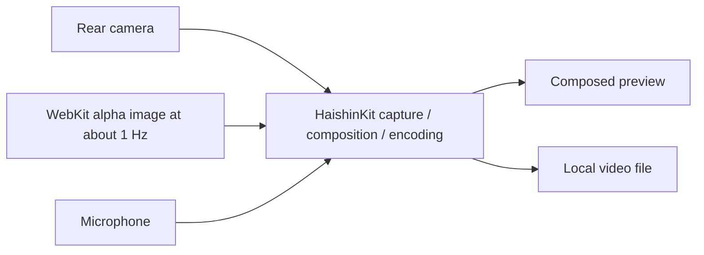

# stream14 application specification and design

Date: 2026-11-01. Status: revised for local-recording MVP; application not implemented.
Owner: Slava Kuznetsov. Source-code license: BSD-3-Clause.

This document is the product and technical source of truth. "Required" describes
the agreed behavior. "Starting default" is an explicit engineering choice that can
be revised using measured results. "Feasibility gate" means the approach is not yet
proven and must not be presented as a working capability.

## Current milestone: local-recording MVP

The owner's 2026-11-01 architecture handoff and subsequent instruction select a
smaller first product: validate HaishinKit camera capture, a transparent web overlay,
and a local video recording before implementing broadcasting. The full YouTube
product remains the destination. Sections below describing YouTube, RTMPS, dual
outputs, TestFlight, and gates A3–A9 are later-stage requirements, not prerequisites
for this MVP. This revision changes documentation only; no library or app is added.

### MVP scope and interface

- Rear wide-angle camera, microphone, landscape 1920×1080 at 30 fps on iPhone 13 mini
  with iOS 27. Use the main profile's starting encoding settings below. No 720p,
  60 fps, HDR, camera switching, manual exposure, or advanced audio controls yet.
- HaishinKit is the first choice to own acquisition, composition, encoding, and
  recording through its verified public APIs. The app owns WebKit snapshots and
  straightforward UI/orchestration. Do not start by building custom capture/encoding
  components or adding a second camera session.
- One configurable HTTPS overlay URL, full 1920×1080 canvas, alpha preserved, with
  approximately one snapshot per second. Retain the last good image through brief
  reloads/errors; hide it after 10 seconds without confirmed source access or a usable
  render, and restore it automatically on recovery. Smooth camera video has priority.
  A small in-place DOM update change
  in the overlay project can be considered if needed; it is not part of this change.
- One native recording screen with composed preview, Record/Stop, recording duration
  and status, permission/error messages, a URL settings sheet, and playback/export
  of saved files through system UI. No YouTube controls, account setup, or full
  recordings-management interface is needed to validate the idea.
- Save composed video and audio persistently in the app container. Prefer MP4 if
  supported by the library's recording path; a playable H.264/AAC MOV is acceptable
  for the MVP if that is the simplest supported path. Record the container choice,
  use its correct extension, and review MP4 compatibility before the full release.
- Start/stop repeatedly, keep the screen awake while recording, restore normal sleep
  afterwards, and finalize on stop/interruption. Show a visible failure and preserve
  saved data if recording fails. Without a network output there is no broadcast to
  continue on recorder failure. Do not automatically resume recording after returning
  from background or after relaunch.
- No YouTube/OAuth, ingestion connection, speculative transport packages, streaming retries, shared
  encoded-output fan-out, backend, Google setup, or TestFlight upload in this stage.
  Test by installing directly from Xcode. No internet is required by recording
  itself; the configured web overlay still needs its own network resources.

Link the core HaishinKit product first. If the verified local recorder API requires
another product, document that specific dependency before linking it; this does not
add network transmission to MVP scope. Avoid custom media work solely to remove a
small, required library product.

### MVP acceptance and decision gate

| Gate | Required evidence on the physical iPhone 13 mini |
| --- | --- |
| M1: Library fit | A stable HaishinKit version builds with the chosen Xcode/iOS 27/Swift 6 setup. Document exact public APIs, product/dependency/license footprint, capture ownership, dynamic image layering, and local-recording route; recording works without publishing or connecting to an ingest server. |
| M2: Actual composition | A saved 1920×1080/30 fps sample and preview contain camera, audio, and the same full-frame web overlay. Check alpha/translucent edges/logos, layout, orientation, a visible score update during recording, and absence of app controls. Repeated reference-page reloads cause no white/blank flashes. |
| M3: Smooth recording | A 30-minute run has less than 1% measured pipeline frame drops, no repeated video stalls of 500 ms or more, no monotonic memory/queue growth, and measured A/V offset within 100 ms at start and end. Document the measurement method and any library observability limits. |
| M4: Local usability and failures | Repeated start/stop produces independently playable/exportable files. Test permission denial, overlay unavailability/reloads, a two-minute overlay-network outage, camera/audio/background interruption, and an injected writer/low-storage failure. During the outage local A/V continues; retain the last overlay briefly, hide at 10 seconds, and restore after fresh source access/rendering. Test a brief outage, an unchanged healthy score, cached snapshots during a failed source refresh, and manual hiding during recovery. Interrupted recordings finalize where possible and the UI reports the actual state. |
| M5: Owner review | Present sample files and a concise feasibility report covering M1–M4, selected library/container APIs, remaining limitations, and the proposed next step. The owner reviews the MVP before work proceeds to broadcasting. |

Crash-fragment recovery, a three-hour soak, wider device coverage, simultaneous local
recording plus RTMPS, and TestFlight are later gates. Preserve incomplete files now,
but do not introduce a custom recovery system solely to finish this first experiment.
A passing MVP does not prove those later capabilities. If library composition or
recording is unsuitable, report the concrete limitation and review a minimal native
adapter or fallback with the owner rather than silently expanding the pipeline.

Record actual APIs and measurements in docs/feasibility.md when implementation
begins; do not create a report claiming success before any device work exists.

## 1. Full-product purpose and agreed requirements

Enable one person to broadcast a long volleyball event from an iPhone without a laptop-based
video mixer. The operator prepares an event in YouTube Studio, opens stream14,
checks the picture and sound, selects that event, and broadcasts with a web overlay
and a local backup.

| ID | Required behavior |
| --- | --- |
| R1 | Capture iPhone camera video and microphone audio. |
| R2 | Load an operator-configurable web URL and composite its transparent, full-frame canvas into the actual video. |
| R3 | Authorize access to YouTube, show the authorized channel and its scheduled events, and let the operator select one. |
| R4 | Resolve or establish that event's ingestion-stream binding, transmit media, and start the selected broadcast. |
| R5 | Save the same composited video and audio locally as a video file. App controls and warnings must not enter the output. |
| R6 | Keep local recording independent of streaming availability for as long as storage and capture/writing remain healthy, including startup failure, transport loss, failed retries, and remote event completion. Reconnect to the same event when possible; streaming failure alone never stops the writer. |
| R7 | If recording fails after broadcasting begins, continue broadcasting and display a persistent warning. Preserve previously saved footage. |
| R8 | Target landscape 1080p30 events lasting approximately one to three hours. Smooth video takes priority over overlay update latency. |
| R9 | Qualify on iPhone 13 mini with iOS 27, and also validate on iPhone 15 and 17 families, including available Pro models. |
| R10 | Use a public GitHub repository, BSD-3-Clause, and TestFlight for the owner and a few invited testers. Prefer native frameworks and minimal justified dependencies. |
| R11 | Hide an overlay after 10 seconds without confirmed source access or a usable render; restore automatically after source access and a fresh render recover, unless the operator manually hid it. Apply this to preview, local recording, and streaming. |

The owner permits changes to the overlay implementation if needed, including
replacing full-page refreshes with in-place updates. Such a change belongs in the
overlay's own project and is not part of this repository's initial documentation
change. It must preserve the configurable web-URL feature.

## 2. Full-release boundaries and starting defaults

| Area | Starting default |
| --- | --- |
| App name / repository | stream14 / smith3v/stream14; display-name styling can change before distribution |
| Platform | iPhone only, iOS 27.0 deployment target; no older-OS compatibility work initially |
| Camera | One rear wide-angle camera; autofocus and automatic exposure; basic supported zoom control |
| Audio | System-selected microphone route, initially qualified with the built-in microphone; mute and visible level meter |
| Orientation | Landscape broadcast canvas, fixed for a session; setup and recordings screens can also work in portrait |
| Main profile | 1920×1080, 30 fps, SDR Rec. 709, H.264 video and AAC audio |
| Lower-bandwidth profile | 1280×720 at 30 fps; selected before a session, without changing resolution during an event |
| Encoding | CBR target, two-second keyframes; initial video targets 14 Mbps for 1080p and 8 Mbps for 720p; AAC 128 kbps stereo at 44.1 kHz, converting the input route as needed |
| Overlay | One HTTPS URL; one full-canvas layer; approximately one raster capture per second, plus a capture after a successful load when practical |
| Backup | One MP4 for an uninterrupted session, using the selected output profile; new files after capture interruptions |
| Operation | Foreground app with automatic screen sleep disabled during recording/broadcasting and restored afterwards |
| Data / services | Direct phone-to-YouTube upload; no application account, relay server, analytics SDK, subscription, or cloud backup service |

The initial bitrates use [YouTube's current encoder recommendations][encoder].
They are not a promise that a given network or phone can sustain the profile.
Measure both profiles before release and document any change rather than silently
reducing the 1080p30 requirement. Do not add 60 fps, HDR, or Pro-only processing to v1.

Creating or editing scheduled broadcasts, changing their visibility, chat overlays,
multiple cameras or overlay layers, live lens switching, portrait broadcasting,
manual RTMP destinations, browser audio, web-page login flows, and background or
locked-screen capture are outside v1. A local rehearsal recording is included so
the operator can test the complete composition without going live.

## 3. Operator experience

### Prepare

The main setup screen presents a composed preview and concise readiness information:
camera/microphone permission, active audio route, overlay loading state, available
storage and approximate recording time, selected output profile, and YouTube
connection/channel/event. Use standard navigation to Settings and Recordings.

Request camera and microphone access when the operator first opens the preview,
explaining both capture and broadcasting. If denied, explain how to enable access
in Settings; do not keep triggering permission prompts. Preview and local rehearsal
must work without connecting a Google account.

Settings allows editing and testing the overlay URL and selecting the output profile.
An empty URL means overlay disabled, stated explicitly in readiness status. The
reference URL is offered as a copyable example, not fetched silently on first launch.
Before a broadcast, a configured overlay must have rendered successfully; if it
cannot load, the operator may explicitly disable it and recheck the preview.

Connect YouTube through Google's supported authorization UI, then display the actual
authorized channel identity. Paginate scheduled events, show title, scheduled time
in the device's locale/time zone, visibility, and eligibility. Provide refresh and a
useful empty state with instructions for scheduling an encoder broadcast in Studio.
Changing accounts clears the previous channel's selection and credentials as appropriate.

### Go live

The final action names the channel, event, and visibility. A clear confirmation
starts this specific event and local recording; opening settings, selecting an
event, or previewing the camera never transmits camera media to YouTube. Check
permissions, output configuration, storage, overlay readiness, authentication, and
event state again before starting.

Start the local writer before publishing media. If backup initialization fails,
do not start the broadcast. Once broadcasting has begun, R7 governs later failures.
Show progress through connecting, waiting for YouTube ingestion, and going live.
Report "Live" only after YouTube confirms the broadcast state. Local recording and
upload connection are separate indicators even during this progress sequence.

### During the event

Use a large, correctly letterboxed preview, elapsed time, microphone level/mute,
zoom, and clear status for YouTube, upload, overlay, and backup. Keep storage/thermal
warnings available without covering the picture unnecessarily. Starting resolution,
canvas orientation, event, and URL stay fixed; provide overlay reload and hide/show
controls rather than navigation that could accidentally change the active event.
Settings changes made later apply to the next session.

The operator can distinguish "Reconnecting; recording continues", "Backup failed;
still live", and "YouTube status unavailable". Warnings are native UI and never
part of the encoded picture. Do not play warning sounds into an active microphone.

### Finish and review

"End broadcast" confirms that the selected YouTube event will end. Request remote
completion, disconnect upload, and finalize the recording regardless of any API
failure. A bounded remote request must not indefinitely delay local finalization.
If completion cannot be confirmed, say "YouTube end not confirmed" and offer a
link to Studio; never imply the remote event ended merely because upload stopped.

The recording screen lists local sessions with date, duration, size, and complete,
interrupted, or failed status. It supports playback, explicit export through the
system share/Files interface, and confirmed deletion. Never delete a local copy
automatically after export, sign-out, or a failed broadcast.

### Interface acceptance

Follow the current [Apple Human Interface Guidelines][hig]. Use native controls,
system text styles and SF Symbols, at least 44-point touch targets, VoiceOver labels,
and text/icons alongside colors. Support larger text in setup and recordings without
truncating essential actions. Test landscape operation on the 13 mini, including safe
areas, permission-denied screens, keyboard entry, and failure warnings. Preserve the
complete 16:9 output in preview; safe areas affect controls, not the video canvas.

## 4. Browser overlay contract

Reference: [the supplied scoreboard][overlay], inspected on 2026-11-01 through a
desktop browser. At inspection it displayed a finished-match scoreboard with logos,
transparent html/body backgrounds, translucent panels, and a JavaScript timer that
reloads the page every 2,000 milliseconds. Its CSS switches to a different layout
at widths at or below 720 pixels. This observation is not an iOS compatibility test
or a claim about other states of the scoreboard.

Required rendering behavior:

- Treat the page viewport as exactly the selected output canvas: 1920×1080 CSS
  pixels for the main profile or 1280×720 for the lower profile. Normalize the
  resulting raster to the same number of video pixels. Do not use the phone's
  display scale to accidentally produce a 3× raster or a narrow mobile layout.
- Preserve full transparency and partial alpha, including antialiased text, shadows,
  logos, and translucent panels. The page defines placement; v1 has no drag/resize
  editor, chroma-key step, or native recreation of the scoreboard.
- Run normal WebKit HTML/CSS/JavaScript and same-page network updates. Output does
  not include scrolling chrome, web permissions, app UI, or browser audio. A
  nontransparent area supplied by the page remains nontransparent; do not secretly
  rewrite arbitrary page styling to remove it.
- Capture at approximately 1 Hz with at most one outstanding capture, reusing an
  immutable last-good raster between captures. Drop/skips of overlay work are
  acceptable under load; stalled camera delivery is not. Smooth animation and
  camera-rate browser rendering are not requirements.
- Keep the last good frame during brief reload, navigation, and transient snapshot errors.
  Promote a new frame after a usable load and render, with resource readiness bounded
  so a failing logo/font cannot freeze capture forever. Do not add an app reload
  timer on top of the reference page's own timer.
- Track source-access health separately from raster capture. A successful page/source
  refresh or health heartbeat counts even when the score is unchanged. Taking another
  snapshot of cached/stale content does not reset source freshness. For in-place page
  updates, establish a minimal source-health signal before claiming to detect their
  network failures; public browser reachability alone does not prove a scoring backend
  is reachable.
- Use a 10-second grace period measured with monotonic time. If confirmed source
  access or usable rendering has been missing for 10 seconds, automatically remove
  the overlay layer from preview, recording, and streaming. Preserve camera/audio
  continuity and show an operator-only overlay-unavailable status. Keep retrying
  without blocking capture. Brief outages keep the last good image without flashing.
- After source access succeeds and a fresh usable image is rendered, automatically
  show that image again and clear the outage status. Do not restore a cached frame
  on network reachability alone, and do not override an explicit manual hide.
- Permit HTTPS URLs with normal certificate validation. Prevent popups, downloads,
  and requests for camera/microphone/location/native access from the page. Do not
  expose credentials or native message handlers to arbitrary overlay content.
  Interactive website sign-in and DRM/video/WebGL compatibility are not promised.

Use WKWebView and public capture APIs first. Apple's [snapshot API][snapshot]
produces an asynchronous image, not a guaranteed real-time video feed. The capture
experiment must verify full-viewport capture, alpha, reload behavior, and performance
with a view attached/rendered in a supported way; do not assume a hidden or detached
web view will render correctly.

If the current page's full reloads cause blank frames or video load, first try a
small change in the overlay project that updates existing DOM content rather than
reloading the document. Document the source endpoint and change there before use;
no undocumented native-to-page protocol is assumed here. Reassess the experience
before adding a new rendering framework or changing the general web-URL contract.

## 5. YouTube authorization and broadcast lifecycle

Use one iOS OAuth client tied to the final bundle identifier. Start with the Google
Sign-In SDK candidate because it implements the supported iOS authorization and
token-management flow. Use URLSession/Codable for the small YouTube REST surface;
a general Google API client or Firebase is not required.

Request a single write-capable YouTube scope required by the chosen endpoints:
`https://www.googleapis.com/auth/youtube.force-ssl`. Explain the requested access;
read-only authorization cannot bind streams or start/end broadcasts. Do not request
additional unrelated data. Store tokens through SDK-managed Keychain storage and
refresh before calls. Never use the overlay browser to collect Google credentials.

| API operation | App use |
| --- | --- |
| channels.list, mine=true | Resolve/display the authorized channel; no assumption that email identifies the channel |
| liveBroadcasts.list, broadcastStatus=upcoming | List scheduled events with snippet/status/contentDetails and all pages |
| liveBroadcasts.list, id=… | Recheck the selected event and reconcile uncertain transitions |
| liveStreams.list, id=… | Resolve an existing bound stream, RTMPS endpoint/key, ingestion activity and health |
| liveStreams.insert | Create an app-owned ingestion stream only when the event has no binding |
| liveBroadcasts.bind | Bind that new stream to the selected upcoming event |
| liveBroadcasts.transition | Explicit transitions to live and complete when the current state permits them |

`broadcastStatus`, `id`, and `mine` are alternative filters for liveBroadcasts.list;
do not combine them. Use the endpoint reference rather than copying an example
that combines filters. See [broadcast listing][broadcast-list], [stream creation][stream-insert],
[binding][bind], and [transition rules][transition].

Reuse an existing compatible binding without changing it. Refuse an ingestion stream
already active or shared with another unfinished event; explain that the user should
configure a dedicated stream in Studio. Do not take over another encoder or silently
replace an incompatible binding. If there is no binding, create one non-reusable,
app-owned RTMP ingestion resource, request variable resolution/frame rate where
supported, and use its returned RTMPS endpoint. Track the created ID immediately so
retrying a later bind does not repeatedly create resources. An ambiguous create
response requires reconciliation or operator action, not blind repeated insertion.

Fetch `rtmpsIngestionAddress` and the stream name/key from YouTube; do not manufacture
an insecure RTMP fallback. Use TLS certificate and hostname validation. RTMPS and
the relevant ingestion fields are described in [YouTube's ingestion guide][rtmps].

Inspect auto-start/auto-stop settings before transmitting:

- Do not change event visibility, title, audience settings, or auto-start/auto-stop
  settings silently. Require the operator to disable auto-stop in Studio for v1 so
  an internet outage does not automatically complete the scheduled event.
- If auto-start is enabled, the confirmed Go Live action authorizes publishing;
  the first transmitted media may itself start the event. Never publish in a
  supposedly private preparation state. Poll for confirmation instead of issuing
  a redundant transition.
- For manual start, publish only after Go Live, wait for the bound stream to become
  active, then request live and verify the event's lifecycle. The optional testing
  state is not required for v1; local rehearsal supplies the preflight check.
- Never repeat a timed-out transition without first reading the current state.
  If the event is completed, do not create another event or claim to resume it.

Poll at about two-second intervals during a bounded startup window of 60 seconds,
and about ten seconds while live. Back off on service errors/rate limits, respect
retry guidance, and avoid tight polling during outages. If startup times out, stop
upload but keep a healthy local recording running; reconcile whether YouTube went
live before offering another stream start. Keep errors such as disabled live streaming, wrong
channel, missing event, insufficient permission, quota exhaustion, and expired consent
distinct and actionable. A failed status check does not require terminating a
healthy ongoing media connection.

The Google account may authorize a Brand Account channel. Show and test the actual
authorized channel; do not assume all Studio-delegated channel roles work with the
API. Reauthorization/channel selection is required if the wrong channel is returned.

## 6. Local recording and storage

Record the pre-upload composition and audio, not a downloaded YouTube rendition.
Network losses therefore create gaps only in the remote output, not in the backup
while capture and local writing remain healthy. The clean-stop result must be a
playable, shareable MP4 with the chosen dimensions, orientation, and synchronized audio.

Once local writing has started, inability to start or maintain a stream must never
stop it: this includes API/startup errors, RTMPS failures, exhausted retries, and an
event ended remotely. Continue until the operator stops recording, storage reaches
the safety reserve, or capture/writing itself fails or is interrupted. Show recording
status separately and provide an explicit Stop recording action when streaming is
unavailable. An intentional End broadcast/recording action still ends both outputs.
An overlay outage changes only the overlay layer under R11, not recording continuity.

Use HaishinKit's verified local recording path first; add a small AVAssetWriter
adapter only if necessary. The MVP's container exception is defined above. Later, prefer
one encoding pass feeding both file and RTMPS output if the library exposes this
cleanly. Do not assume APIs or packet access exist. If a second encode is necessary,
measure its thermal and performance cost before accepting it.

Store working and completed recordings in the app's persistent Application Support
area, excluded from automatic device/iCloud backup. Use a UUID and timestamp for
filenames, an in-progress marker, and a small Codable session manifest; no database
is needed. Only mark a file complete after writer finalization succeeds. An interrupted
capture starts a new file rather than appending a new timeline to a closed MP4.

Evaluate fragmented MP4 writing with an initial ten-second fragment interval and
recovery of fully written fragments after process termination. Apple's
[fragment-writing documentation][fragments] describes a recovery mechanism, not a
guarantee that any interrupted file will play. Qualify the selected container/writer
combination and recovery/export behavior on the device. Keep incomplete files for
recovery or explicit deletion; never silently discard them. A crash can still lose
the current fragment and must be described honestly.

Display estimated space/time from the selected bitrate and actual free capacity.
At 14 Mbps video plus 128 kbps audio, three hours is approximately 19.1 GB before
container overhead; at 8 Mbps it is approximately 11.0 GB. These are decimal GB
estimates, not reserved storage or maximum file sizes. Warn when capacity is below
the intended event length. Block startup below 1 GiB free, warn persistently below
approximately ten minutes remaining, and stop/finalize local writing before free
capacity reaches 250 MiB where possible. Continue the live broadcast after a later
recording failure, with an explicit degraded-backup state.

Playback/export requires no Photos-library permission. Export is deliberate; the
system Files picker can include iCloud destinations. Explain that a file kept only
inside the app is lost if the app is deleted. Do not call this local copy a disaster
recovery backup until the operator exports it elsewhere.

## 7. Architecture, ownership, and interfaces

Use one Xcode iOS app target plus focused unit and UI test targets. Keep small
feature folders and concrete services; avoid a package-per-feature architecture.
The following are responsibilities and boundaries, not a requirement to create a
protocol for every class.

| Responsibility | Owns |
| --- | --- |
| SwiftUI screens and session coordinator | User intent, readiness, state presentation, and start/stop ordering |
| HaishinKit media pipeline | Capture, timing, image composition, encoding, and local recording where supported by its public APIs; one camera session |
| Web overlay renderer | Main-actor WKWebView, loading/capture health, and last-good alpha image |
| YouTube client and authorization adapter | Tokens, REST requests, channel/event selection, ingestion binding, lifecycle reconciliation |
| Output orchestration | Local writer lifecycle, file persistence/export; later, bounded RTMPS output and independent failures |

The diagram is the preferred MVP experiment, not a verified library integration.
Verify that dynamically updated alpha images appear in the preview and the local
file, and that recording does not require a live transport connection. A small
native recording adapter is acceptable if required by the public API; do not assume
the library handles every responsibility or automatically shares encoded samples.

The fallback is Apple-native capture/composition/recording with HaishinKit used later
for RTMPS. This entails more buffer, timing, and encoding ownership, so use it only
after documenting a specific library limitation and reviewing the change. An
external encoded-input interface to HaishinKit must also be verified before choosing
that fallback. Core Image is the first custom compositing option if needed; custom
Metal requires profiling evidence. ReplayKit is not the initial capture design.

For the later broadcaster, investigate simultaneous file and RTMPS output and
independence under connection failure before choosing shared or separate encoders.
Do not add transport plumbing to the MVP merely to investigate this future question.

Use monotonic capture timestamps for A/V synchronization and wall time only for
labels/filenames. Serialize media ownership, bound queues, and handle backpressure
separately for file and transport. If dropping network backlog is necessary, recover
on a keyframe rather than accumulating an unbounded delay. Main-actor image updates
must not race a compositor that is reading the previous image.

Track independent recording, transport, overlay, and YouTube states. In particular,
transport connected is not equivalent to live, and recording failed is not equivalent
to broadcast ended. A session manifest records only the minimum information needed
to identify local files and reconcile an interrupted session. Refresh transient
YouTube metadata rather than retaining an indefinite API-response archive.

## 8. Interruptions and recovery

| Condition | Expected behavior |
| --- | --- |
| Wi-Fi/cellular outage or streaming failure | Keep capture and local recording running while storage/capture/writing remain healthy; reconnect to the same eligible binding with delays capped at 30 seconds, without stopping the recorder if retries fail |
| YouTube event completed elsewhere | Stop sending to it, keep local recording running, and show that the event ended; no automatic replacement event; offer Stop recording |
| Overlay reload/error | Keep last-good image for brief errors, hide after 10 seconds without source access or usable rendering, automatically restore a fresh image after recovery unless manually hidden; keep camera/audio smooth |
| Local writer/storage failure | Preserve written data; continue upload; persistent backup-failure indication |
| Camera/audio interruption or app background/lock | Stop upload and finish local writing with the background execution time available; no guaranteed continuous capture; show interrupted state on return |
| Foreground return after interruption | Recheck permissions, capture, writer, and remote state; require an explicit resume; create a new local file and resume only if the same event still permits it |
| Sustained heat/system pressure | Warn, prioritize camera delivery by reducing/skipping overlay work; if capture is no longer safe/available, interrupt cleanly; no silent resolution changes |
| Access-token expiry/revocation | Refresh supported tokens; if reauthorization is needed, keep an already healthy media connection where possible and explain the control-plane limitation; do not put login UI into recorded video |
| App crash/termination | On next launch inspect unfinished files and reconcile remote state; offer recovery; never auto-start publishing on launch |

No background-mode entitlement is a workaround for the foreground scope. Screen
sleep prevention is active only while needed and does not defeat the user's manual
lock. An event can remain open on YouTube after capture stops; the interface must
not imply otherwise. A new session after interruption may produce another backup file.

## 9. Privacy, service policies, and dependencies

- Store the complete overlay URL in Keychain because it may contain access tokens;
  keep nonsecret preferences in UserDefaults. Do not log stream keys, authorization
  headers, URL paths/query strings, or raw API bodies containing sensitive data.
- A public OAuth client ID is expected in a native binary. Never embed a confidential
  client secret, signing key, or user refresh token in the repository or build config.
- Provide separate disconnect/revoke authorization and local-recording deletion
  controls. Clear stored YouTube API data on disconnection or detected revoked access;
  do not delete the user's original recordings as if they were cached API data.
- Before the beta, publish accurate privacy and terms pages, explain Google/YouTube
  and third-party overlay requests, link required Google/YouTube policies, and expose
  a developer contact and authorization-revocation instructions. There is no separate
  stream14 account to register or delete. Follow [YouTube's developer policies][policies].
- Apple's third-party-client exception in review guideline 4.8 is relevant to
  connecting YouTube; adding an unrelated application account would require a new
  review of the login requirements. This is a design interpretation, not approval
  from Apple. Review the actual app against the [current guidelines][review].
- MVP dependency direction: HaishinKit for capture/composition/local recording.
  GoogleSignIn and RTMPHaishinKit are deferred until the broadcasting stage. Inspect stable-release
  APIs, iOS 27/Swift 6 compatibility, transitive dependencies, privacy manifests,
  maintained status, notices, and the shared-recording path before pinning versions.
  Do not link SRT/WebRTC/MoQT products or add Firebase for convenience.

The upstream [2.2.5 README][hk-readme] advertises bitmap mixing, the
[package manifest][hk-package] separates HaishinKit and RTMP products, and the
[license file][hk-license] states BSD-3-Clause. These source checks support the
experiment, not claims that dynamic alpha updates, local file composition, shared
encoding, iOS 27 compatibility, or network-independent dual outputs have passed.
Recheck the current stable release and complete API/notice review before adoption.

## 10. Later full-product acceptance gates and test matrix

M1–M5 above determine MVP completion. A1/A2 remain useful shared video-quality
criteria; the table below qualifies the eventual broadcaster, not the local-only MVP.

| Gate | Evidence required |
| --- | --- |
| A1: Overlay feasibility | On the 13 mini, a recorded 1080p30 sample contains the reference page at the full 1920×1080 viewport with correct alpha, text, logos, and no app controls; repeated two-second page reloads do not introduce white/blank flashes |
| A2: Smooth video | A 30-minute compositing/recording run sustains the selected 30 fps profile with less than 1% pipeline frame drops, no repeated stalls of 500 ms or more, and no monotonic memory/queue growth |
| A3: YouTube end-to-end | Correct channel and scheduled event selected; confirmed start, playback on a second device, correct overlay/audio, and confirmed end; selecting/previewing alone sends no camera media |
| A4: Independent backup | Startup/API rejection, two-minute internet loss, failed reconnects, and a remotely completed event leave healthy local A/V running while storage remains available. Restoring connectivity resumes only the same eligible event. An overlay outage hides the layer after 10 seconds and restores a fresh image after recovery, without interrupting recording. |
| A5: Recording recovery | Clean MP4 plays and exports; forced app termination preserves demonstrably recoverable completed fragments or the limitation is resolved before claiming crash recovery |
| A6: Failure UX | Permission denial, missing/disabled events, expired consent, quota/rate-limit responses, unreachable overlay, local writer failure, low storage, and unknown remote completion are distinct and actionable |
| A7: Long event | A three-hour 1080p30 broadcast and local recording on the 13 mini, powered and on a stable qualified network, satisfies A2 quality targets and keeps measured A/V offset within 100 ms at start and end |
| A8: Devices/interface | Physical tests on the 13 mini and available iPhone 15/17 representatives; Pro variants use no required Pro-only behavior; test 720p, audio interruptions, screen lock/backgrounding, VoiceOver, larger text, playback/export, and cancellation |
| A9: TestFlight | Signed archive uploaded and installed through an invite on a tester phone; privacy declarations/notices and beta review information reflect actual behavior |

Automate API decoding/pagination, readiness, lifecycle reconciliation, retry/cancellation,
and independent failure-state decisions with fixtures and fake services. Exercise
media timing and files with synthetic frames/audio where useful. Use physical phones
for alpha correctness, camera/audio routing, heat, real network changes, crash recovery,
and long runs. Simulator success cannot establish those claims.

Record hardware, OS/build, app commit, output profile, overlay URL/fixture version,
network conditions, power state, ambient conditions, duration, output files, frame
statistics, memory/thermal observations, and failures for a qualification run. Keep
private recordings and credentials out of the public repository.

For long-event qualification, record tripod/mount, wired power source, case,
brightness, airflow, and thermal behavior. First test without external cooling;
no power-bank or cooler model is selected. Consider a dimmed in-app foreground UI
or external cooling only after measurement; neither is an MVP requirement. Any
cooler evaluation must include microphone noise and mounting interference. No
claim about battery longevity or cooling effectiveness is established by this design.

If the 13 mini fails a gate, document the measurements and revise the design with
the owner. Do not quietly change the minimum device, claim 1080p support on the
basis of a newer phone, or add infrastructure before testing simpler changes.

## 11. Delivery sequence and unresolved setup

Start with documentation and licensing, then Xcode/device setup and HaishinKit API
evaluation, then the local-recording MVP and M1–M5 review. Continue to YouTube/RTMPS
only after that review, then independent-output failure handling, long-event
qualification, and the small TestFlight beta. Detailed
work prompts are in [the implementation plan](2026-11-01-stream14-implementation.md).

The Apple team membership, final bundle identifier, Google Cloud project/OAuth
client, tester list, and public privacy/support URLs must be supplied/configured
before distribution. Do not fabricate them or commit private identifiers, tokens,
or tester addresses. These are setup prerequisites, not reasons to delay local
camera/overlay feasibility work.

## References

Primary sources checked on 2026-11-01; service policies, package APIs, and submission
requirements must be rechecked when their milestone is implemented.

[overlay]: https://heren14-overlay.smith3v.com/overlay.html
[hig]: https://developer.apple.com/design/human-interface-guidelines/
[snapshot]: https://developer.apple.com/documentation/webkit/wkwebview/takesnapshot(with:completionhandler:)
[fragments]: https://developer.apple.com/documentation/avfoundation/avassetwriter/moviefragmentinterval
[encoder]: https://support.google.com/youtube/answer/2853702
[broadcast-list]: https://developers.google.com/youtube/data/live/reference/rest/v3/liveBroadcasts/list
[stream-insert]: https://developers.google.com/youtube/data/live/reference/rest/v3/liveStreams/insert
[bind]: https://developers.google.com/youtube/data/live/reference/rest/v3/liveBroadcasts/bind
[transition]: https://developers.google.com/youtube/data/live/reference/rest/v3/liveBroadcasts/transition
[rtmps]: https://developers.google.com/youtube/data/live/guides/rtmps-ingestion
[policies]: https://developers.google.com/youtube/terms/developer-policies
[review]: https://developer.apple.com/app-store/review/guidelines/
[hk-readme]: https://github.com/HaishinKit/HaishinKit.swift/blob/2.2.5/README.md
[hk-package]: https://github.com/HaishinKit/HaishinKit.swift/blob/2.2.5/Package.swift
[hk-license]: https://github.com/HaishinKit/HaishinKit.swift/blob/2.2.5/LICENSE.md
